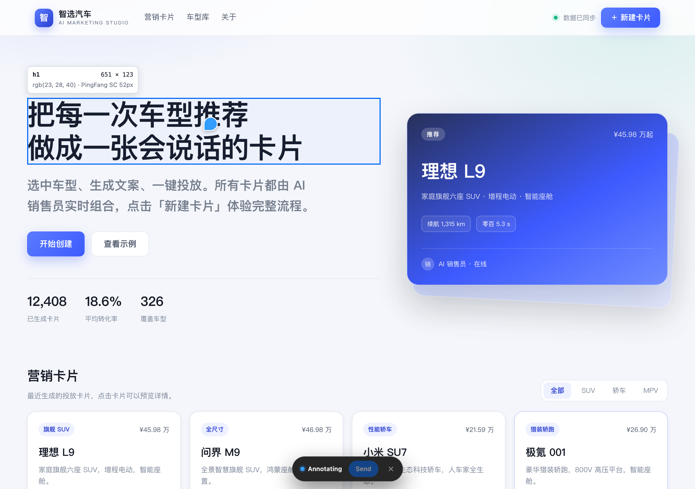
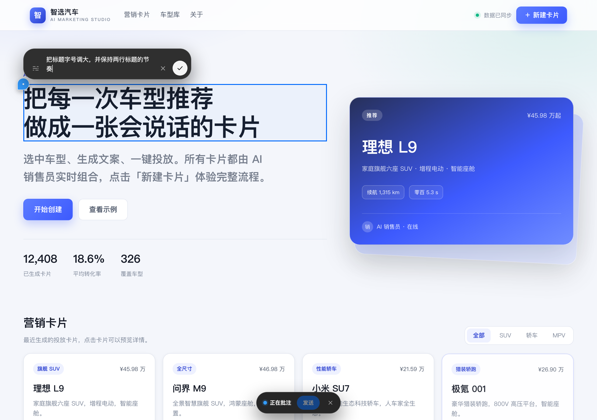
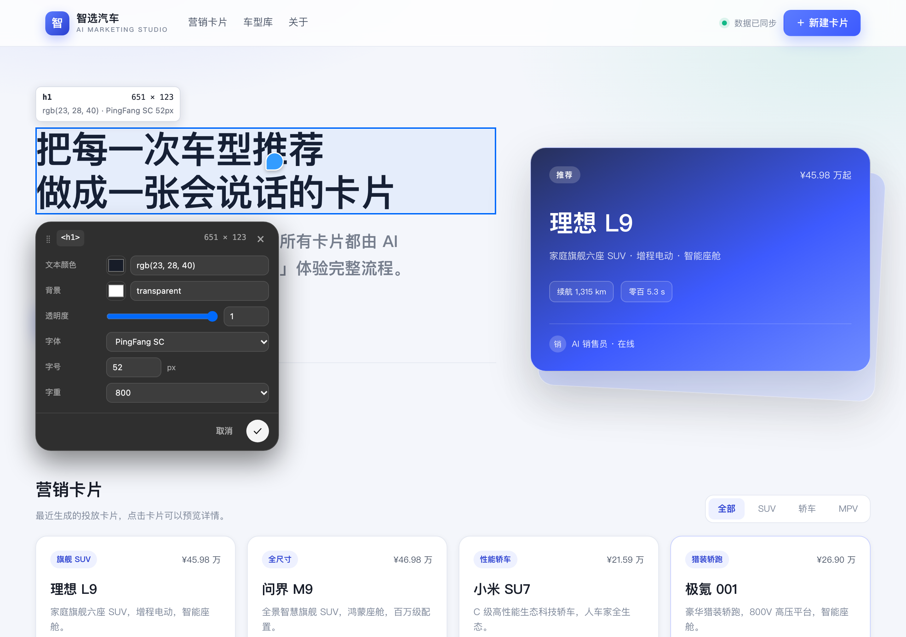
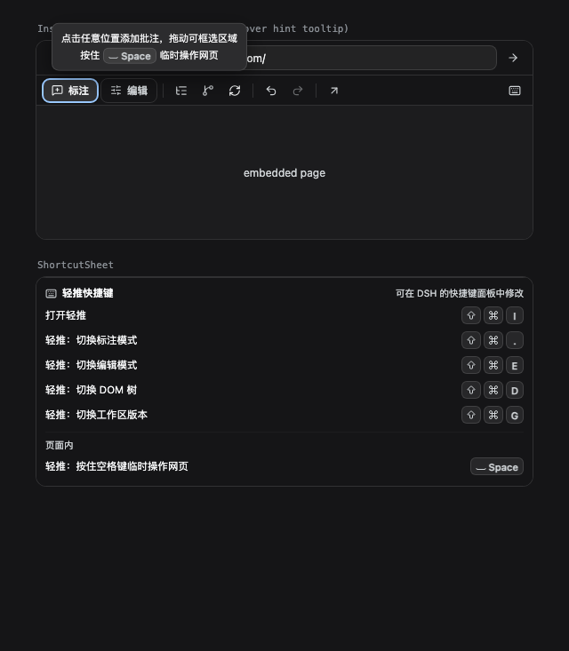

# Nudge（轻推）· 在网页上直接改，交给 AI 收尾

**点一下页面上的任意元素，写一条批注交给 AI 去改；也可以自己把样式、文字调到满意为止，改完自动写回源码。**

Nudge（中文名「轻推」）是 DSH Desktop 的一个插件。它把网页装进右侧边栏，让你像在 Figma 里指指点点一样操作真实的线上页面——不用截图、不用描述“就是那个蓝色的按钮”，指到哪儿，改的就是哪儿。



> 样式和文字的修改**实时生效**，不需要点保存：你改完输入框，页面立刻变；写回源码在后台自动完成，状态条会告诉你「已写回源码」还是「仅预览」。

## 这是什么

一句话：**把“这里改一下”直接指给 AI，或者自己动手改到对。**

- 你在 DSH 右侧浏览器里打开一个网页。
- 点「标注」，点中要改的地方，写下意见，发送给 AI。
- 或者点「编辑」，直接拖滑块、改颜色、改文字，所见即所得。
- 改完的效果会自动对应回工作区的真实源码。

面向 UI 设计师、产品经理，以及任何需要“这行字再大一点、这块留白再多一点”的人。

## 能解决什么问题

- **说不清“改哪里”**：截图、画圈、写“就那个按钮”，沟通成本高。现在直接点在元素上，AI 拿到的就是准确的元素位置和你的原话。
- **等实现、等排期**：一句话的视觉调整也要走一遍需求流程。现在自己先改出来，效果对了再落源码。
- **改了不知道有没有生效**：样式实时预览，源码自动同步；没写进去会明确告诉你原因，而不是假装成功。
- **改版不敢动**：工作区版本面板可以回看历史版本、切分支、勾选文件提交，改坏了能退回去。


## 三步上手

1. **打开轻推**：按 `⌘⇧I`（Windows / Linux 用 `Ctrl+Shift+I`）；或点击右侧边栏「浏览器」卡片 →「在轻推中打开」；或打开任意浏览器标签后，点标签的 `⋮` 菜单 →「在轻推中打开」。
2. **打开一个页面**：地址栏输入网址；也可以直接打开你工作区里的 HTML 页面（工具栏「工作区版本」→「文件」）。
3. **开始改**：
   - 点「标注」→ 点元素、拖框或拖选文字 → 写下想让 AI 怎么改 → 点「发送」。
   - 点「编辑」→ 点元素 → 在弹出的样式卡里实时调整 → 自动写回源码。

## 主要功能

### 标注：把意见钉在页面上

- 点「标注」进入标注模式，鼠标扫过哪里，哪里就高亮；元素上方会显示它的尺寸、颜色、字体，方便你描述。
- 三种标注对象：**点单个元素**、**拖框选一块区域**、**拖选一段文字**。
- 每一条批注都会变成页面上的编号小圆点，不会挡住你的设计稿；点圆点还能回来改。
- 页面底部是「正在批注」浮条，可以拖动位置、定位最新一条、隐藏标记，或者一键丢弃不要的批注。
- 按住 **空格** 可以临时像正常浏览网页一样滚动、点链接、填表单，松开立刻回到标注状态。



### 编辑：所见即所得地改样式和文字

- 点「编辑」进入编辑模式，点击元素会弹出悬浮样式卡；页面保持满宽，不挤占你的画布。
- 可以改：
  - **文字**：内容、颜色、字体、字号、字重、行高、字距、对齐；
  - **布局**：宽高、显示方式、定位、溢出；
  - **间距**：外边距、内边距、元素间距；
  - **外观**：背景、透明度、边框、圆角、阴影；
  - **高级**：变换、层级、可见性。
- 所有修改立即生效，并且可以**撤销 / 重做**；连续拖动滑块会合并成一步，不会撤销到手酸。
- 还能做结构编辑：删除元素、拖动元素调整顺序或换个父级。结构修改同样先预览、后写回。



### DOM 树：想选哪一层就选哪一层

工具栏的「DOM 树」会在页面右侧列出整棵元素树，也就是页面的层级结构。点任意一层，页面会自动滚到它、选中它；编辑模式下同时打开样式卡。弹窗、抽屉、动态插入的内容也都能选。

### 工作区版本：像看历史记录一样改页面

点工具栏的「工作区版本」，右侧会打开一个面板，分三页：

- **文件**：列出工作区里的 HTML 页面，点一下就打开预览。在 DSH 里打开工作区文件夹后，第一次打开轻推会自动定位首页。
- **版本**：看到当前分支、有没有未提交的改动、本地分支列表，以及当前文件最近的历史版本。可以切换分支，也可以把某个文件恢复到历史版本。
- **提交**：勾选要保存的改动文件，写一句说明，直接提交。也可以只提交其中几个文件。

如果工作区有未提交的改动，切换分支前会先问你「存起来并切换」还是「先去提交」，不会悄悄丢东西。

### 页面自动刷新

工作区里的文件一有变化，页面就自动刷新（也就是常说的热更新）——你自己改的、AI 改的、同事改的都算。标注或编辑到一半时不会打断你，只会提示「有更新，回到浏览模式后自动刷新」，回到浏览模式立刻刷新。

### 交给 AI

点「发送」后，批注会变成对话框里的一张卡片：元素缩略图、你的意见、以及这次已经改过的样式，都会一起进入下一条消息的上下文。发送前可以改、可以删；发送成功后卡片自动清空。

### 设置

设置 → 左侧「轻推」是产品偏好页：界面语言、标注 / 编辑 / DOM 树 / 工作区版本 / 页面自动刷新开关、右键菜单开关，以及「关于与更新」卡片。所有开关点一下立即生效。

### 深浅色

跟随 DSH 的 Light / Dark 主题，不单独维护开关。浮层、样式卡、标注点、工具栏都会跟着换色。



## 从插件市场安装

1. 打开左侧边栏的「插件」页（设置 → 插件），切到「发现」标签页。
2. 点「添加索引源」（就是插件列表的地址），填入：

   ```
   https://raw.githubusercontent.com/qizhi2design/nudge/main/market/index.json
   ```

3. 在列表里找到 **Nudge（轻推）**，点「安装」，确认即可。

> 没有「发现」标签页时，说明当前 DSH 版本还没有启用插件市场，可以改用本地安装，或升级 DSH。

## 自动更新

- 从插件市场安装的正式版：DSH 启动时会**自动检查一次新版本**；设置 →「轻推」→「关于与更新」里如果有新版本，会显示「立即更新」按钮，点一下就能升级，重启 DSH 后生效。
- 也可以随时点「检查更新」手动检查。
- 本地开发版（用 `link` 方式装进 DSH 的版本）不参与在线更新，设置页会如实提示，避免你以为自己装的是正式版。

## 快捷键

所有快捷键都能在 **设置 → 快捷键** 里查看和改键；工具栏右侧的键盘按钮会展开当前生效的组合。

| 动作 | macOS | Windows / Linux |
| --- | --- | --- |
| 打开轻推 | `⌘⇧I` | `Ctrl+Shift+I` |
| 进入 / 退出标注模式 | `⌘⇧.` | `Ctrl+Shift+.` |
| 进入 / 退出编辑模式 | `⌘⇧E` | `Ctrl+Shift+E` |
| 切换 DOM 树 | `⌘⇧D` | `Ctrl+Shift+D` |
| 切换工作区版本 | `⌘⇧G` | `Ctrl+Shift+G` |
| 切换批注（标注模式内） | `↑` / `↓` | `↑` / `↓` |
| 退出标注 / 编辑模式 | `Esc` | `Esc` |
| 临时操作网页（按住） | `Space` | `Space` |

标注和编辑各自有独立的开关热键：按一次进入，再按一次退出；两个模式之间也可以直接切换。进入标注模式后，`↑` / `↓` 会在已添加的批注之间循环切换（当前批注会自动滚到视口内并打开批注编辑框），`Esc` 先关闭弹层，再退出标注 / 编辑模式。悬停工具栏的「标注 / 编辑」就能看到当前生效的键位和这些操作提示。

页面里还有几个顺手的小操作：输入批注时 `Enter` 添加、`Shift+Enter` 换行；`Shift+Tab` 在标注与编辑之间切换。

## 常见问题

**Q：我在线上网站上改了样式，会改到别人吗？**
不会。修改只在你自己的浏览器里预览；只有页面能对应到你本机工作区的源码文件时，才会写回你本地的文件。线上服务器不会被动到。

**Q：为什么有时候提示「预览」，没写进源码？**
说明插件没找到能安全写入的源文件——比如页面是 JS 动态生成的、元素在源码里不唯一，或者当前工作区是只读的。提示里会写具体原因，照着调整一下再试即可。

**Q：改坏了怎么办？**
样式改动可以撤销 / 重做；已经写回源码的改动，可以在「工作区版本 → 版本」里把文件恢复到历史版本。建议先把工作区纳入 git 管理，回退更安心。

**Q：标注会发给谁？**
发给当前对话里的 AI。发送前它会变成一张可编辑的卡片，你可以补充说明、删掉不要的条目，再和其他消息一起发出去。

**Q：支持哪些页面？**
任何 HTTP / HTTPS 网页都能打开、预览和标注。要把修改写回源码，页面需要对应你本机工作区里的文件（本地 HTML、Vue / Svelte / Astro 页面，或你自己的本地开发服务器）。

**Q：为什么有的元素删不掉、拖不动？**
删除和拖动只支持 HTML、Vue、Svelte、Astro 这类页面文件；对 JS / JSX / TSX 里的结构做修改会弄坏代码，所以会明确拒绝。文字和样式编辑不受影响。

**Q：找不到「轻推」入口？**
按 `⌘⇧I`；或在右侧边栏「浏览器」卡片里选「在轻推中打开」；或在浏览器标签的 `⋮` 菜单里打开。也可以在「设置 → 轻推 → 功能」里检查对应入口是不是被关掉了。

**Q：可以只让页面变好看，不交给 AI 吗？**
可以。标注和编辑是两条独立的路，你可以只调样式、只用标注，或者两个都用。

## 给开发者

<details>
<summary>技术实现、目录结构、构建与测试（点击展开）</summary>

**技术栈**：TypeScript + React（右侧边栏界面）+ Electron `<webview>`（页面载体）+ 页面内 Shadow DOM 注入层（浮动 UI）+ esbuild / Tailwind 构建。样式修改先实时作用到页面，再进入后台队列合并写回源文件。

**目录**：

```
src/           插件源码（界面 / 插件后台 / 页面注入层）
lib/           构建产物（不要手改）
locale/        中英文界面文案
docs/          设计系统、源码同步、工作区版本等开发文档
test/          工程测试与 fixtures
scripts/       构建脚本
```

**常用命令**：

```bash
npm install
npm run typecheck      # TypeScript 检查
npm run build          # 构建：页面注入层 → 插件后台 → 界面，产物写入 lib/
npm test               # 全部工程测试（不需要 Chrome）
```

**深入阅读**：

- [源码同步契约](docs/source-sync.md)：样式 / 文字 / 属性 / 结构修改如何定位并写回源文件。
- [结构编辑回写诊断](docs/dom-structure-sync.md)：删除 / 拖动为什么有时只能预览，以及定位策略。
- [工作区版本接口契约](docs/workspace-versions.md)：文件预览、历史版本、分支与提交。
- [设计系统与组件规范](docs/DESIGN_SYSTEM.md)：颜色 token、组件、图标与交互细节。
- [验收记录](docs/ACCEPTANCE.md)：逐项功能与截图证据。

**发布**：包名 `@huangqz/dsh.nudge`，插件市场索引地址为
`https://raw.githubusercontent.com/qizhi2design/nudge/main/market/index.json`。

</details>

## English

**Nudge** is a plugin for DSH Desktop. It puts a real web page in the right sidebar: point at any element and leave a note for your AI assistant to fix it, or adjust styles and text yourself and watch the page update live. Every change is written back to your source files automatically.

- **Annotate**: click an element, drag a region or select text, then describe what to change.
- **Edit**: tune text, spacing, colors and layout in a floating card, with undo / redo.
- **Workspace versions**: browse files, switch branches, restore history and commit.

Install from the plugin market: open **Plugins → Discover**, add the index source
`https://raw.githubusercontent.com/qizhi2design/nudge/main/market/index.json`, then install **Nudge**. Requires DSH Desktop.
