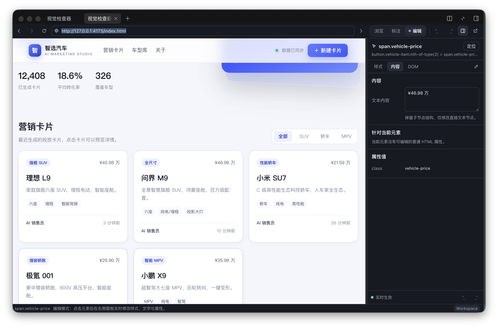
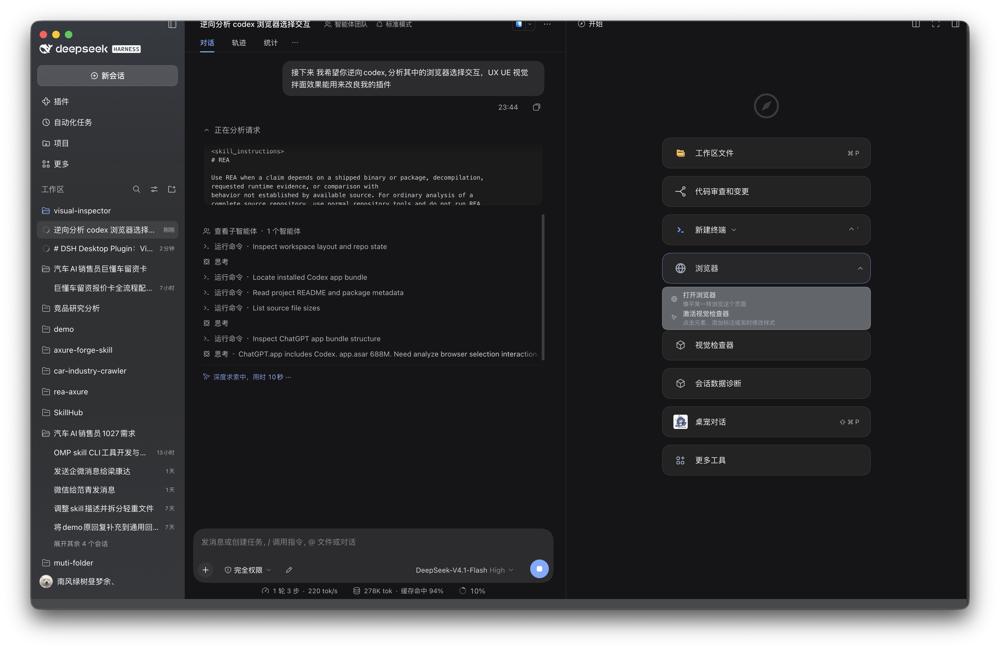
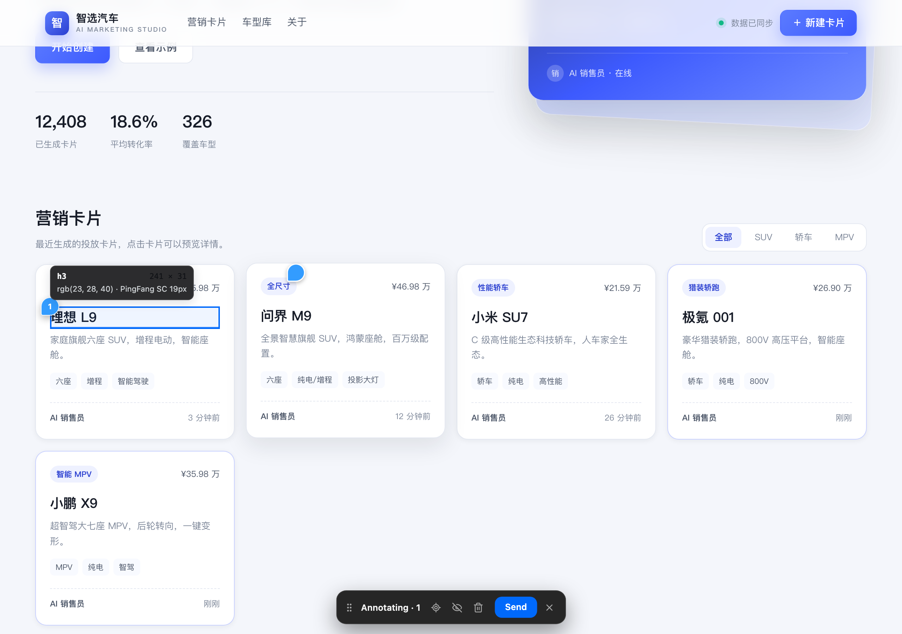

# Nudge · 标注与微调

DSH Desktop 原生插件（插件包 `dsh.nudge`，插件 ID `dsh.nudge`）。名字里的 **Nudge** 既是「点一下」也是「轻轻推一把」：指中页面上的任意元素 → 标注它交给 AI 去改，或者自己动手微调样式、文字与属性，直到看起来对了。

在 DSH 右侧边栏内直接打开网页，用 **Codex 风格的点击标注、批注浮条和悬浮样式卡** 检查、标注并实时修改当前页面；视觉修改会异步持久化到当前 Workspace 的真实源码，标注与修改记录会整理成结构化上下文交给当前 Agent。

它同时是一个**本地工作区版本浏览器**：扫描工作区（`sourceRoot`）里的 HTML 文件并用内置静态预览服务器打开，读取 git 分支 / 脏文件 / 单文件历史，在面板内切分支、把页面恢复成历史版本、勾选改动直接 `git commit`；文件被任何人（插件同步、你、Agent/AI）修改后页面会自动热更新。

> 样式编辑 **实时生效**：没有「确认 / 应用 / 保存」按钮。用户改完输入框，Chromium 立即重绘，随后后台同步源码。

> **仓库结构**：本目录是插件本体仓库（`dsh.nudge`），可独立构建 / 发布 / 共享给客户。同级还有两个独立 git 仓库：
> `../demo/`（演示页面，测试验证用）与 `../validation/`（本地静态服务 + 真实 Chromium CDP 验收测试 + 截图生成）。
> 三个目录各自独立管理，互不提交对方文件。



## 功能

- **浏览（Browse）**：页面保持原生交互。
- **标注（Annotate）**：Codex 风格选择反馈（气泡光标、2px 高亮 + 内描边、元素元数据浮层、编号 pin marker、150ms 缓动）；支持点击元素、拖拽框选、拖选文字三种批注对象；标注只以编号 pin 留在页面上（不再显示页面左下角评论卡）；底部浮条采用 Codex 布局（拖拽手柄 + 定位 / 隐藏标记 / 丢弃 + 发送 + 退出），发送时把批注作为 clip 卡片放进对话框。
- **临时接管页面**：标注 / 编辑模式按住 **Space** 可临时恢复页面原生交互（滚动、点链接、操作表单），松开立即回到检查状态。
- **编辑（Edit）**：工具栏「编辑」入口打开 Codex 风格悬浮样式卡；页面默认保持满宽，没有右侧属性 Dock。实时修改样式，改动立即生效，历史记录支持撤销 / 重做、手势合并。
- **浮动样式卡**：页面内完成样式速调，旧右侧属性 Dock 已删除。
- **多级弹窗**：一级抽屉、二级对话框、遮罩、滚动容器、动态插入 DOM 均可选中；选中框与真实元素几何一致，关闭弹窗后自动清理选中态。
- **源码同步**：编辑操作进入后台队列，debounce 合并，连续修改只写一次；成功才显示「已同步」，未映射 / 失败显示「预览」并保留运行时效果。
- **工作区版本**：工具栏新增「工作区版本」入口，右侧停靠面板列出工作区（`sourceRoot`）里的 HTML 文件并直接用内置 `127.0.0.1` 静态预览服务器打开；识别 git 仓库的当前分支 / 脏文件 / 本地分支 / 单文件历史，支持切换分支（脏工作区要先提交或暂存）、把页面恢复成某个历史 commit 的版本，以及勾选改动文件 + 填写 message 直接 `git commit`。
- **热更新**：Host 监视工作区文件变化，Client 轮询 revision；浏览模式下页面自动刷新，标注 / 编辑模式改为提示「有更新」，回到浏览模式再刷新。插件自己的样式同步、用户手改、Agent/AI 编辑都会触发同一套刷新。
- **交给 Agent**：点「插入」把标注变成对话框里的 **clip 批注卡片**（元素截图缩略图 + 标签 + 意见，可编辑 / 删除，带「N 条注释」计数 chip），随用户下一条消息一起发送；已生效的视觉修改与截图路径同样并入这条消息的上下文。
- **设置面板**：设置 → 左侧边栏「轻推」页直接读写本插件在 profile 里的配置（源码根目录 / URL 前缀 / 扫描上限 / 单文件上限），保存即写回 `cordis.patch.yml` 并由 Loader 生效。
- **窄宽度工具栏**：右侧边栏变窄（或打开工作区 / DOM 停靠面板）时，工具栏自动分成两行——第一行只保留后退 / 前进 / 刷新 / 地址栏 / 前往，第二行放标注 / 编辑、DOM / 工作区 / 自动刷新、撤销 / 重做 / 外部；地址栏不再被图标挤扁，极窄时再收起前进与「前往」按钮（Enter 仍可提交）。
- **DSH 原生 UI**：右侧边栏 Tab、设置页、主题 Token、Light/Dark 自适应；不改变 DSH 一级布局。
- **组件化实现**：宿主 UI 使用 **React + TypeScript + shadcn-style Button（CVA）+ Radix Tooltip + lucide-react + Tailwind（`dshnudge-` 前缀，`components.json` 配置）**；页面注入层保持 Vanilla Shadow DOM，避免污染任意站点。

## 打开方式

1. 快捷键 **⌘⇧I**（Windows/Linux `Ctrl+Shift+I`）打开轻推。
2. 或**点击右侧边栏引导卡片「浏览器」**：卡片会展开子级菜单 —— **打开浏览器** / **激活轻推**，选择后者直接打开轻推（不再单独占用引导卡片）。
3. 或打开任意内置浏览器 Tab 后，点击该 Tab 的 **⋮ 菜单 → 在轻推中打开**：会把该 Tab 当前的 URL 带给新的轻推标签页（`ctx.sidebarRight.tabDomain` 读取导航参数）。
4. 或在聊天里右键链接 → **在轻推中打开**。



地址栏输入 HTTP(S) 地址即可打开页面。打开后可用右侧边栏的「全屏」按钮把 Browser Workspace 展开到整窗宽。

## 使用

### 标注

1. 点击工具栏 **标注** 开关进入批注模式（再次点击退出）。
2. 悬停页面元素查看高亮与元数据（标签、尺寸、文字颜色、字体）；点击元素，或拖拽框选区域，或直接拖选页面文字。
3. 元素旁出现 Codex 风格 Composer 胶囊（表面颜色跟随宿主 Light / Dark）：输入意见，**Enter** 添加，**Shift+Enter** 换行。标注模式下 Composer 只负责写意见，不再提供「调整样式」入口（样式调整走工具栏「编辑」）。
4. 已保存的标注只保留编号 pin（文字选区保留高亮），页面不再显示浮动评论卡；点 pin、或再次点击已标注的元素，都会重新打开原批注编辑（不会重复新建）。批注的编辑与删除也可以在对话框的 clip 卡片上完成。
5. 页面底部是 Codex 风格的「正在批注 · N」浮条：左侧六点拖拽手柄可移动位置，中间是定位最新批注 / 隐藏标记 / 丢弃批注三个动作，右侧蓝色 **发送** 与 **×** 退出。点 **发送** 把当前标注与已生效的视觉修改一起放进对话框：输入框上方浮出 clip 卡片，输入框顶部出现「💬 N 条注释」chip；点 chip 展开 / 收起，卡片上可编辑意见、删除单条。页面内的 pin 在发送后清除，避免两边重复。
6. 在对话框里补一句说明后正常发送：插件会把页面 URL、selector、元素文本、意见、截图路径和视觉修改追加到这条消息的上下文里；发送成功后 clip 卡片自动清空，发送失败会保留以便重试。
7. 需要操作页面时按住 **Space**，页面恢复原生交互；松开回到标注模式。

### 编辑

1. 点击工具栏 **编辑** 开关进入设计模式（Composer 滑杆也可进入同一张卡）。
2. 点击页面元素，元素旁出现 Codex 风格悬浮样式卡（344px，表面颜色跟随宿主 Light / Dark），页面保持满宽。默认展开「文本内容 + 文字样式」，其余分组折叠：
   - **文本内容**（默认展开，仅当元素有可直接编辑的文本节点时出现）：直接文本节点；
   - **文字样式**（默认展开）：颜色 / 字体 / 字号 / 字重 / 行高 / 字距 / 对齐；
   - **布局**（折叠）：宽度 / 高度 / display / position / overflow；
   - **间距**（折叠）：margin / padding / gap；
   - **外观**（折叠）：背景 / 透明度 / 边框 / 圆角 / 阴影；
   - **高级**（折叠）：transform / z-index / visibility。
   点击分组标题即可展开 / 收起；所有修改实时生效并进入撤销栈与源码同步队列。
3. 卡片底部 **取消** 会回滚本次卡片内的修改，圆形 ✓ 保留修改；Esc 等同取消。
4. 工具栏的 **DOM 树** 按钮会在页面右侧打开侧边栏：懒加载的 DOM 树，点节点直接选中并把页面滚动到该元素（编辑模式下同时打开样式卡），当前选中节点会高亮、祖先自动展开。
4. **撤销 / 重做** 按钮位于工具栏；连续拖动滑块或连续输入会合并为一次历史操作。
5. 源码同步在后台队列执行；失败通过顶部提示条显示，不阻塞当前预览。

### 工作区版本（文件 / 分支 / 提交 / 热更新）

1. 点击工具栏的 **工作区版本**（GitBranch 图标）打开右侧停靠面板；面板有三个 tab：**文件 / 版本 / 提交**。
2. **文件**：列出 `sourceRoot`（默认会话工作目录）里的 HTML 文件，支持筛选。点文件名 → Host 为该 `sourceRoot` 启动（或复用）一个 `127.0.0.1` 静态预览服务器，返回 `http://127.0.0.1:<随机端口>/<相对路径>` 并在页面里打开；同一个 root 复用同一端口，`previewStop` 或插件 Host 半区卸载时关闭。
3. **版本**：
   - 顶部显示仓库名、当前分支与脏工作区状态；
   - 「分支」列出本地分支，点击切换；工作区有未提交改动时提供 **暂存并切换**（`git stash push -u`）或 **先去提交** 两个选择，不会静默丢弃改动；
   - 「版本」列出当前 HTML 文件最近 40 个 commit（没有选中文件时显示仓库最近提交），点 **恢复此版本** 需要二次确认，执行 `git checkout <commit> -- <file>` 把这个文件的工作区内容换成历史版本（不动分支指针，之后可以正常提交）。
4. **提交**：列出当前改动文件（带 已修改 / 新增 / 删除 / 重命名 / 未跟踪 / 冲突 标签），默认全选；填提交说明后点 **提交** → `git add -- <勾选文件>` + `git commit -m <message>`。也可以只勾选部分文件提交。hook 失败会原样显示 stderr 摘要，不会谎报成功。
5. **热更新**：工具栏的刷新图标是自动刷新开关（默认开启）。Host 用 `fs.watch`（120ms debounce）维护单调递增的 revision；Client 约每 900ms 轮询一次：
   - **浏览模式**下 revision 变化 → debounce 120ms 后 `webview.reload()`；
   - **标注 / 编辑模式**下不打断当前操作，只显示「页面有更新，回到浏览模式后自动刷新」，回到浏览模式立即刷新；
   - 插件自己的样式同步、用户手改、Agent/AI 编辑都会触发同一条链路；外部 dev server 的页面同样适用（变化来自工作区文件监视，不依赖页面侧注入）。
6. 只读策略（`read-only`）下：文件扫描、git 状态 / 历史、静态预览、热更新仍然可用；切换分支、恢复版本、提交会被 Host 拒绝并在面板显示原因。

### 主题（Light / Dark）

插件整体跟随 DeepSeek Harness 桌面的主题设置，不单独维护开关：

- **宿主 UI 读 Token**：DSH 把 `--dsw-alias-*` 调色板发布在 `<body>` 上（不是 `<html>`），并同步切换 `body[data-ds-dark-theme]`。Client 的主题桥（`src/client/platform/theme.ts`）在 body 上读取 base / layer / border / label / brand / hover 等 token，`useDshTheme()` 首次订阅时挂上 `theme/change` 事件、body 属性 `MutationObserver` 与 `prefers-color-scheme` 监听。
- **主题切换即时重渲染**：字号、边框、悬浮态、clip 卡片、工具栏、DOM 树侧栏都从当前 palette 推导，宿主切换 Light / Dark 时订阅者重新渲染，不刷新页面；只有调色板真正变化时才通知订阅者。
- **页面注入层跟随**：Client 把 `themePaletteForRuntime(theme)`（`accent` / `panelBg` / `text` / `border` / `muted` / `danger` / `isDark`）通过 `setTheme(...)` 推给注入的页面运行时；运行时按 `isDark` 在 `OVERLAY_DARK` / `OVERLAY_LIGHT` 之间切换，Composer、悬浮样式卡、底部批注条、编号 pin 与 metadata 浮层一起换肤。主题在标注 / 编辑过程中翻转也会就地重绘（已打开的 Composer 与已建好的底部条都会更新）。
- **兜底策略**：iframe / webview 尚未注入或非 DSH 宿主没有 token 时，按 `prefers-color-scheme`（以及 dark 属性）选择对应的 fallback palette。

### 设置

设置面板左侧的「轻推」页是这个插件自己的配置页，与「项目目录」「桌宠配置」同级：

- **源码根目录**（`sourceRoot`）：页面 URL 映射到的源码目录，留空使用会话工作目录；必须位于工作区内，工作区外的值会被忽略并按 cwd 处理。
- **URL 前缀**（`urlRoot`）：映射到源码根目录的 URL 前缀，例如 `http://127.0.0.1:4173/`；留空用页面自身 origin。
- **最多扫描文件数**（`maxScanFiles`，20 – 5000）：URL 无法直接映射时按 token 打分搜索源码的文件数上限。
- **单文件大小上限**（`maxFileBytes`，16 KB – 16 MB）：单次源码同步可读取的最大文件字节数。

字段右侧会标出「已覆盖」——表示该字段已被写进 profile patch；「恢复默认」把四个字段一次性写回 schema 默认值。保存通过 Host 的 `configEditor` 写回 profile 的 `cordis.patch.yml`，并由 Loader 重新应用这一行，所以保存后立即生效、也不需要手动改文件；设置面板右上角的「打开配置文件」打开的是同一个文件。写入会让本插件的 Host 半区重载一次，页面在保存后会重新读取快照再报告结果。

## 架构

```
dsh.nudge
├── src/
│   ├── client/                       # Web Client 半区 → lib/client.js
│   │   ├── domains/                  # 业务域
│   │   │   ├── carrier/              # 内嵌页面载体（Electron webview / same-origin iframe）
│   │   │   ├── annotation/           # 标注面板与会话标注索引
│   │   │   ├── inspector/            # 轻推 Tab body：工具栏 + 页面 + 发送
│   │   │   ├── browser/              # 内置浏览器引导卡与 Tab ⋮ 菜单接入
│   │   │   ├── workspace/            # 工作区版本面板（文件 / 分支 / 提交）与热更新判定
│   │   │   ├── settings/             # 设置 → 轻推 配置页（读写 profile patch）
│   │   │   └── persistence/          # 视觉编辑同步队列与源码提示
│   │   ├── platform/                 # 插件接入：常量 / store / remote / theme / history / prompt / bootstrap
│   │   ├── shared/                   # 跨域原语与纯工具
│   │   └── ui/                       # shadcn 风格 React UI（Button / Tooltip / Toolbar / Tailwind）
│   ├── host/                         # Node Host 半区 → lib/index.js
│   │   ├── index.ts                  # session / 沙箱 / nudge/* API / 截图落盘
│   │   ├── source-sync.ts            # 持久化域 facade（保持 Host 入口稳定）
│   │   ├── workspace.ts              # 工作区域 facade → lib/workspace.js
│   │   ├── domains/workspace/        # git 仓库识别/操作、HTML 扫描、静态预览服务器、文件 watcher
│   │   └── domains/persistence/      # 源码映射、有界搜索、CSS/HTML 补丁、元素定位
│   └── runtime/                      # 注入页面的运行时 → lib/runtime.js
│       ├── domains/                  # core / overlay / annotation / design / selection / editing / interaction
│       └── lifecycle/                # 生命周期与 window.__DSH_NUDGE__ API
├── cordis.patch.yml                  # bundle patch，插入 Host row
├── test/                            # 工程测试与 fixtures
├── docs/workspace-versions.md        # 工作区版本 / 静态预览 / 热更新接口契约
└── scripts/                          # build.mjs + build-{runtime,host,client}.mjs
```

### 工作区版本、静态预览与热更新

```
workspace()  ── 会话 cwd / sourceRoot / 沙箱策略 / git 状态 / HTML 扫描 / preview 状态
     │
     ├─ 文件 tab ── previewOpen(file) → http://127.0.0.1:<port>/<file> → webview.load
     │
     ├─ 版本 tab ── gitSwitch(branch[, {stash}]) / gitRestoreFile(file, commit) → webview.reload
     │
     └─ 提交 tab ── gitCommit(message, files) → git add + git commit

watchPoll() ~900ms ── Host fs.watch(revision++) ── Client hotReloadDecision
       ├─ browse  → reload（120ms debounce）
       └─ annotate/edit → reloadPending + 提示，回到 browse 再 reload
```

- **静态预览服务器**：每个 `sourceRoot` 一个，`127.0.0.1` + `listen(0)` 自动端口，只服务该 root 下的静态文件；`GET/HEAD`、MIME 表、`Cache-Control: no-store`、`/` 与目录回落到 `index.html`；拒绝目录穿越、符号链接逃逸、点文件、`.git` 与 `node_modules` 段。页面侧不注入任何脚本，因此外部 dev server 的页面也能用同一套热更新。
- **git 操作**：全部走 `execFile('git', …)`，不经 shell；仓库必须位于会话 cwd 内，且与 `sourceRoot` 有重叠（相同 / 仓库在 `sourceRoot` 内 / `sourceRoot` 是仓库子目录三种都支持）。所有 API 路径统一相对 `sourceRoot`，Host 内部按 `relativeRoot` / `sourceSubdir` 换算成仓库路径；`git.changes` 会过滤掉 `sourceRoot` 之外的文件。只切换本地分支；脏工作区必须显式 stash 或先提交，不做 `reset --hard` / `clean`。
- **Client 不拥有文件访问**：所有 stat / watch / git / 静态服务都在 Host 半区；Client 只经 `nudge/*` RPC 拿快照与 revision。`lib/workspace.js` 是独立构建产物，`lib/index.js` 通过 `./workspace.js` 引用它。

### 与 DSH 的集成方式

- **不新建浏览器**：复用 DSH 桌面端右侧边栏 Browser 的 Electron `<webview>` guest lease 机制（`window.dshDesktop.browser.acquire/release`），继承主进程隔离策略（无 Node、无下载、无权限、HTTP(S) 白名单、独立存储分区）。
- **不修改一级布局**：注册新的右侧边栏 Tab 类型 `nudge`（`ctx.sidebarRightTabs.register`）及 `sidebar.right.pane.tab` body；不注册独立引导卡片，入口收进 `sidebar.right.tab.guide.entry` 扩展的「浏览器」卡片子菜单（以及浏览器 Tab ⋮ 菜单、链接右键菜单、快捷键）。
- **页面内渲染浮动 UI**：Electron webview 是原生层，宿主 DOM 无法覆盖在其上方，因此 Composer、编号 marker、浮动样式卡、底部批注条都由注入的页面运行时用 Shadow DOM + inline CSS 渲染；位置随元素滚动 / 重排刷新。
- **设计改动回传宿主**：浮动样式卡在页面内直接应用 CSS，同时把 `design-style` 事件回传给 Client；Client 负责写入历史并进入源码同步队列，不重复应用样式。
- **与 Agent 通信**：插入时把标注/视觉修改写入 Session 维度的 clip 草稿，并注册到 `conversation.input.overlay`（输入框顶部锚点）与 `conversation.composer` 的会话作用域；发送时包装 `conversation.sendSession()`，把 clip 上下文追加到用户消息后，成功才清空草稿、失败则恢复。不另建 Agent 或消息系统。

### 实时预览 vs 源码持久化

```
用户输入（页面 Composer / 浮动样式卡）→ 本地校验/规范化 → runtime.applyStyle/Text/Attr（inline CSSOM/文本节点）
        → Chromium 立即重绘 → 记录操作（可撤销/重做）
        → debounce 队列（550ms，按 selector+property 去重合并）
        → Host nudge/sync（会话 cwd + 沙箱策略）
        → source-sync 定位真实源码 → 版本校验后写入
        → 返回 synced / preview / failed → 面板状态
```

- 预览不依赖模型，也不等待源码写入。
- 源码写入遵循 Workspace 现有授权：只写会话 cwd 内文件；`read-only` 策略下只返回 `preview`，绝不写盘。
- 只有真实写入成功才显示「已同步」；失败保留预览并明确提示。

### 源码定位策略（按优先级）

1. 页面 `data-source` / `data-source="file:line"` 提示，以及 CSS 规则来源 `styleHref + styleSelector`。
2. 页面 URL → Workspace 路径映射（仅 loopback 或配置的 `urlRoot`）。
3. 有界源码搜索（跳过 `node_modules/.git/dist`，按 id/class token + 文本片段打分）。
4. 静态 HTML：样式写入 `<style id="dsh-nudge-overrides">`，刷新后仍生效；文本/属性只改对应文本节点或属性，保留子节点结构。
5. CSS 文件：平衡大括号定位规则，更新/插入声明，返回行号；`.vue/.svelte/.astro` 走组件 `<style>` 块并提示 scoped 限制。

## 配置

Host 插件 Config（`cordis.patch.yml` 的 `config`）。同样的四个字段可以在 **设置 → 轻推** 里直接编辑，由 Host 的 `configEditor` 写回 profile patch：

| 字段 | 默认 | 说明 |
| --- | --- | --- |
| `sourceRoot` | `''` | URL 路径映射到的源码目录；空 = 会话 cwd。必须在 cwd 内，否则忽略。 |
| `urlRoot` | `''` | 页面 URL 与 sourceRoot 的前缀映射，如 `http://127.0.0.1:4173/`；空 = 页面 origin。 |
| `maxScanFiles` | `400` | 无法直接映射时最多扫描的源码文件数。 |
| `maxFileBytes` | `2000000` | 单个源码文件读取上限。 |

两条路径等价：设置页写入的是同一个 profile patch 行，手工编辑 YAML 后 Loader 同样会重新应用。

`sourceRoot` 同时是**工作区版本面板、HTML 扫描与内置静态预览服务器**的根目录：留空 = 会话 cwd；设成仓库子目录时，git 功能仍可用（面板路径相对 `sourceRoot`，仓库内、`sourceRoot` 之外的改动会被过滤掉）。git 仓库必须位于会话 cwd 之内，否则面板显示仓库不可用。

## 测试

```bash
node test/client-smoke.mjs            # Client bundle 工厂 + 所有注册项 + 响应式工具栏阈值（47 checks）
node test/client-theme.test.mjs       # 宿主主题桥：body token / 深色翻转 / 系统兜底 / store 通知 / 组件渲染（36 checks）
node test/settings-page.test.mjs      # 设置 → 轻推 页：读取 / 编辑 / 保存 / 只读降级（21 checks）
node test/workspace-panel.test.mjs    # 工作区版本面板：文件 / 分支 / 提交 / 恢复 + hotReloadDecision（99 checks）
node test/clip-annotations.test.mjs   # clip 草稿存储 + 占位/恢复 + 发送上下文（39 checks）
node test/runtime-smoke.mjs           # 页面运行时 API/行为（257 checks）
node test/source-sync.test.mjs        # 源码持久化（23 groups / 125 assertions）
node test/workspace-domain.test.mjs   # 真实临时 git 仓库：扫描 / 分支 / 提交 / 恢复 / 预览服务器 / watcher（235 assertions）
node test/host-integration.test.mjs   # 真实 Host 插件 + 真实临时工作区 + 配置桥（47 checks）
node test/workspace-e2e.test.mjs      # 端到端：workspace → previewOpen → 改文件 → watchPoll → commit → 切分支 / 恢复 / 只读（58 checks）
```

最近一次结果：

- `client-smoke`：ok / 47 checks
- `client-theme`：36 checks / 0 failures
- `settings-page`：21 checks / 0 failures
- `workspace-panel`：99 checks / 0 failures
- `clip-annotations`：39 checks / 0 failures
- `runtime-smoke`：257 checks / 0 failures
- `source-sync`：23 groups / 125 assertions，exit 0
- `workspace-domain`：235 assertions / 0 failures（真实 git 仓库 + 真实静态服务器）
- `host-integration`：ok / 47 checks（含配置桥 config / configUpdate、style / text / attr / CSS / 重置 / 只读 / 截图 PNG）
- `workspace-e2e`：58 checks / 0 failures（真实 Host 插件 + 真实 git 仓库 + 真实 HTTP 预览 + watcher revision）

> 真实 Chromium 的 CDP 集成与 Light / Dark 截图验收不在本仓库运行：它们在同级 `../validation/` 仓库执行
> (`node runtime-cdp.mjs` / `node theme-cdp.mjs`)，会读取本仓库 `lib/runtime.js` 并把两张证据截图写回
> `docs/evidence/`。本仓库的 `npm test` 不依赖 Chrome 或 demo 页面。

## 验收证据

当前逐项说明见 [docs/ACCEPTANCE.md](docs/ACCEPTANCE.md)。截图由同级 `../validation/` 仓库的 CDP 验收测试生成，并在此保留副本供 README 与客户查看。

| 证据 | 文件 |
| --- | --- |
| Codex 风格悬停：气泡光标 + 元数据浮层 |  |
| Codex 风格标注 Composer（中文、Enter 添加） |  |
| 编号 pin marker + 选中框 |  |
| Codex 风格浮动样式卡（编辑模式） |  |
| 底部批注条（Codex 布局） |  |
| 文字选择批注 + 编号 pin |  |
| Light 主题：白色底部批注条 + 白色 metadata 浮层 + 编号 pin |  |
| Dark 主题：`#262626` 底部批注条 + `#2c2c2e` metadata 浮层 + 编号 pin |  |

## 已知限制

- 源码持久化是**文本级补丁**：可直接处理静态 HTML/CSS、内联文本、普通属性；打包产物、CSS-in-JS、CSS Modules 变量、数据驱动的 JS 对象内容会诚实地停留在 `preview`。
- 样式重置只会删除插件自己写入 HTML override 块中的声明；用户已有样式表中的重置仍为 `preview`（避免误删作者样式）。
- 标注的 `region` / 文字选区 `textSelection.rects` 保存拖拽时的视口坐标，页面滚动后框不会跟随（元素标注会按 selector 实时重算）。
- 标注 / 历史 / 选中状态保存在 Client 内存中（每个 Tab）。刷新页面会重新注入运行时并重放当前未撤销的视觉修改；插件重载会清空标注列表。
- clip 批注草稿按 Session 保存在 Client 内存中：插件热重载 / 页面刷新会清空；同一份标注重复插入会按 annotation id 合并，不会重复出卡。
- 发送时 clip 上下文以 Markdown 追加在用户消息之后（DSH 的对话消息没有原生批注附件渲染位），消息气泡里会看到这段结构化文本。
- 工作区版本 / git 功能要求仓库位于**会话 cwd 内**且与 `sourceRoot` 有重叠；会话从仓库子目录打开（仓库根在 cwd 之外）时面板会显示仓库不可用，不会越界操作。`sourceRoot` 是仓库子目录时可用，但仓库内、`sourceRoot` 之外的改动不会出现在提交面板里（`gitCommit` 省略文件列表时仍是仓库范围的 `git add -A`）。
- 只支持本地分支切换；不做 push / pull / merge / rebase / reset --hard / clean。脏工作区切换分支必须显式「暂存并切换」或先提交，插件不会静默丢弃改动。
- 恢复历史版本是**整文件覆盖**（`git checkout <commit> -- <file>`），没有逐行 diff / cherry-pick；恢复会同时改动工作区与索引，需要的话再提交。
- 内置静态预览服务器只服务 `sourceRoot` 内的静态文件（拒绝点文件、`node_modules`、`.git`、目录穿越与符号链接逃逸）。依赖构建流程（Vite / Next 等）的页面请把 dev server URL 填进地址栏，版本与热更新功能仍然可用。
- 热更新通过 webview reload 实现：会重建页面运行时并重放当前未撤销的样式修改；标注 pin / 文字选区在自动刷新后不保留（与手动刷新行为一致）。标注 / 编辑模式下只提示不刷新，避免打断当前操作。
- 嵌套在 `sourceRoot` 内部、且 `sourceRoot` 本身不在任何仓库里的独立子仓库不会被自动发现（只按 `git rev-parse` 探测，不做 `.git` 递归扫描）。
- watcher 的 stat 轮询兜底已实现但未做故障注入测试（macOS 上走递归 `fs.watch`，Linux 递归 watch 依 Node 版本可能退化到轮询）。
- Web（非 Desktop）载体只支持同源 iframe 页面；DSH Desktop 的 Electron webview 是主要目标。
- 极窄的停靠宽度下建议把 Browser Workspace 展开 / 全屏使用。

## 构建

```bash
npm install
npm run typecheck      # tsc --noEmit
npm run build          # 编排：runtime → host → client，产物写入 lib/
npm run build:runtime  # 仅页面运行时 → lib/runtime.js
npm run build:host     # 仅 Host + 持久化域 + 工作区域 → lib/index.js / lib/source-sync.js / lib/workspace.js
npm run build:client   # 仅 Client bundle → lib/client.js（内嵌 lib/runtime.js）
npm test               # client + runtime + source-sync + workspace + host 集成 + E2E（不需要 Chrome）
```

> `lib/` 是构建产物目录，不要手改；三个半区可以独立构建，`npm run build` 只负责按依赖顺序编排。

## 设计系统

- [Codex 风格设计系统与组件规范](docs/DESIGN_SYSTEM.md)：tokens、组件、图标、交互逻辑与验收清单。

## 逆向参考（Codex 桌面端）

- [Codex 桌面端「浏览器元素 / 文字选择 + 批注」交互逆向拆解](docs/codex-browser-selection-teardown.md)：状态机、视觉 token、Shadow DOM/top-layer、iframe/滚动容器/zoom 边界、与插件的差异矩阵。
- [Nudge 标注交互差距分析与升级方案](docs/nudge-gap-analysis.md)：B0 基线 → P0/P1/P2 路线图、逐项验收标准、测试覆盖缺口。

本轮统一落地：工具栏「标注 / 编辑」双入口；编辑使用 22px 悬浮样式卡；24px Composer 胶囊；页面只保留 pin marker（不显示浮动评论卡）；底部「正在批注 · N」Codex 风格浮条；26px pin marker；文字拖选批注；Space 临时接管；`#0069FB` 选择框 + `#339cff` marker 双色 token；旧右侧属性 Dock 已移除。页面浮层不再固定深色：宿主 Light / Dark 切换时，宿主 UI 从 `<body>` 的 `--dsw-alias-*` 重读 palette，并通过 `setTheme(isDark)` 让 Composer、样式卡、底部条、pin 与 metadata 浮层一起换肤（Dark 覆盖层数值与旧版逐字节一致）。

## 目录

```
cordis.patch.yml         bundle patch
lib/index.js             Host 构建产物（源：src/host/index.ts）
lib/source-sync.js       源码持久化构建产物（源：src/host/domains/persistence/）
lib/workspace.js         工作区域构建产物（源：src/host/domains/workspace/）
lib/runtime.js           页面注入运行时构建产物（源：src/runtime/domains/ + lifecycle/）
lib/client.js            Client 构建产物（勿手改）
src/client/domains/      业务域：carrier / annotation / inspector / browser / workspace / settings / persistence
src/client/platform/     插件接入：constants / store / remote / theme / history / prompt / bootstrap
src/client/shared/       跨域原语与纯工具
src/client/ui/           React + TypeScript + Radix + Lucide + Tailwind 组件层（toolbar / Tooltip / Button）
src/host/                Host 入口 + workspace.ts（工作区域 facade）+ domains/persistence + domains/workspace
src/runtime/             注入运行时：domains/ 按域拆分，lifecycle/ 生命周期与 API
scripts/build.mjs        构建编排（runtime → host → client）
scripts/build-runtime.mjs  页面运行时拼接 + esbuild transform → lib/runtime.js
scripts/build-host.mjs     Host transform + 持久化域 / 工作区域 bundle → lib/index.js / lib/source-sync.js / lib/workspace.js
scripts/build-client.mjs   esbuild + Tailwind → lib/client.js
tsconfig.json            TypeScript strict 配置
tailwind.config.cjs      dshnudge- 前缀，避免污染 DSH
components.json          shadcn 兼容配置

locale/{zh,en}.json      文案
test/                    工程测试与 fixtures（真实 git 仓库 E2E；CDP 验收在 ../validation）
docs/DESIGN_SYSTEM.md    Codex 风格设计系统 / tokens / 组件规范
docs/workspace-versions.md 工作区版本 / 静态预览 / 热更新接口契约
docs/ACCEPTANCE.md       验收记录（CDP / 截图验收由 ../validation 生成）
```
