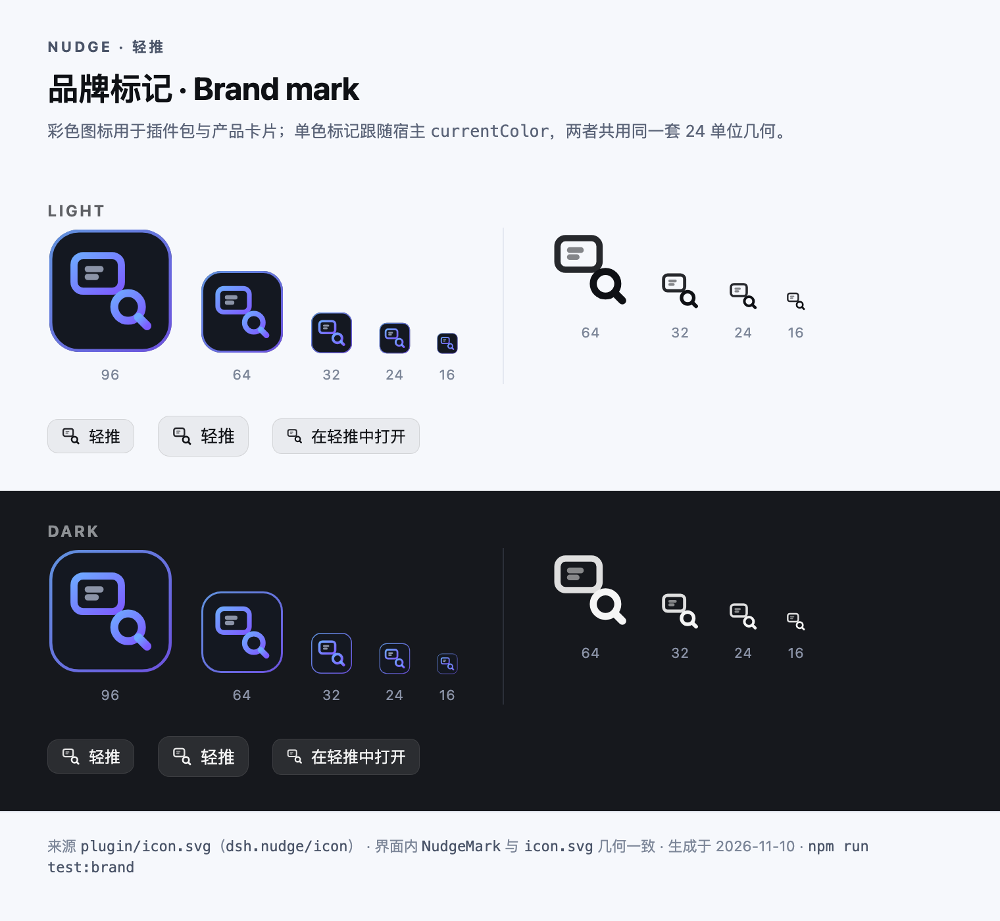

# Nudge · Codex 风格设计系统

> 目标：把宿主 React 工具栏与页面注入层（Vanilla Shadow DOM）统一到同一套 Codex 视觉语言和交互逻辑，旧右侧属性 Dock 已移除。

## 1. 交互逻辑（Codex 模型）

```
browse ──[标注 / 编辑 toggle 或 ⌘⇧. / ⌘⇧E（可在快捷键面板改键）]──> comment / edit
comment ──[再按同一热键 / Esc]──> browse
comment ──[↑ / ↓]──> 上一条 / 下一条批注（编辑框跟随，不抢输入焦点）
comment ──[元素 + 滑杆]──> design card（comment 的子视图）
comment ──[点击/拖选/拖文字]──> composer ──[发送]──> agent
comment ──[Space]──> browse（临时，松开恢复）
comment ──[Esc / ×]──> browse
```

- **两个一级入口**：「标注」进入 comment，「编辑」进入 edit；两者共享同一套页面交互与 design card，编辑只使用页面内悬浮卡。
- **独立模式热键**：标注 / 编辑各有一个可改键的开关热键，按一次进入、再按一次退出；在另一个模式里按键直接切过去。工具栏「标注 / 编辑」的 hover tooltip 会列出当前生效键位、「再按一次退出」、`↑` / `↓` 切换批注与 `Esc` 退出。
- **键盘浏览批注**：标注模式下 `↑` / `↓` 循环切换已有批注：滚动定位 + 闪一下 + 打开该批注的编辑框（不抢焦点，保证连续按有效）；焦点进入编辑框后方向键恢复光标移动。没有批注时方向键继续滚动页面。`Esc` 先关样式卡 / 编辑框，再退出标注或编辑；焦点在宿主工具栏 / Dock 时同样可用。
- **三种批注对象**：元素、区域、文字选区。
- **Space 临时接管**：按住恢复页面原生交互，松开回 comment；`Esc` 可退出接管。
- **保存即落卡**：标注保存后进入页面左下角浮动评论卡；底部浮动条负责发送 / 退出。
- **轻量关闭**：`Esc` 先关闭 design card / composer，再退出 comment。

## 2. Design Tokens

### 2.1 页面覆盖层（Codex Light / Dark，跟随宿主主题）

注入层维护两套 Codex 表面 palette：`OVERLAY_LIGHT` / `OVERLAY_DARK`（`src/runtime/domains/core/00-bootstrap.ts`），由宿主 `setTheme({ isDark })` 选择，**Dark 数值与旧版固定深色层逐字节一致**。覆盖层不直接使用 DSH 品牌 token，保证在任意站点上都可读。

| Token | `overlay.dark` | `overlay.light` | 用途 |
| --- | --- | --- | --- |
| `overlay.bg` | `#2f2f2f` | `#ffffff` | Composer / 悬浮样式卡 |
| `overlay.bgStrong` | `#262626` | `#ffffff` | 底部批注条 |
| `overlay.text` | `#f5f5f5` | `#0f1115` | 主文字 |
| `overlay.muted` | `#a5a5a5` | `#61666b` | 次要文字 / 图标 |
| `overlay.border` | `rgba(255,255,255,0.10)` | `rgba(15,17,21,0.12)` | 1px 描边 |
| `overlay.hover` | `rgba(255,255,255,0.08)` | `rgba(15,17,21,0.06)` | 图标 / 行 hover |
| `overlay.field` / `fieldStrong` | `rgba(255,255,255,0.065)` / `rgba(255,255,255,0.16)` | `rgba(15,17,21,0.04)` / `rgba(15,17,21,0.10)` | 输入框 / 选中行 |
| `overlay.highlight` | `rgba(255,255,255,0.07)` | `rgba(15,17,21,0.05)` | chip / 分组 hover |
| `overlay.submitFill` / `submitInk` | `#f5f5f5` / `#111111` | `#0069FB` / `#ffffff` | Composer 提交按钮（启用） |
| `overlay.submitFillDisabled` / `submitInkDisabled` | `rgba(255,255,255,0.16)` / `#f5f5f5` | `rgba(15,17,21,0.08)` / `#61666b` | Composer 提交按钮（禁用） |
| `overlay.accent` | `#0069FB` | `#0069FB` | 选择框 / 主按钮 |
| `overlay.marker` | `#339cff` | `#339cff` | pin / 光标 |
| `overlay.onAccent` | `#ffffff` | `#ffffff` | accent 上的前景色 |
| `overlay.shadow` | `0 16px 40px rgba(0,0,0,0.48)` | `0 16px 40px rgba(20,30,50,0.18)` | 浮层阴影 |
| Composer placeholder | `rgba(255,255,255,0.42)` | `rgba(15,17,21,0.50)` | 输入框占位文字 |

`MetaTooltip` 不走 Codex 表面 token，而是直接复用宿主推入的 palette（`panelBg` / `border` / `text` / `muted`）：Light 为 `#ffffff` / `#0000001f` / `#0f1115` / `#61666b`，Dark 为 `#2c2c2e` / `#ffffff1f` / `#f9fafb` / `#cfd3d6`，因此与 DSH 主题逐项对齐。

宿主在 `setTheme` 时同时更新已打开的表面：Composer 重排并重绘，底部批注条由 `applyBarTheme()` 就地换色，`<style>` 里的 placeholder 也按当前 palette 重写；正在编辑的悬浮样式卡因控件样式全内联，会关闭后按新主题重建。

### 2.2 形状 / 字号 / 动效

| Token | 值 |
| --- | --- |
| Composer 圆角 | `24px`（单行胶囊） |
| Design card 圆角 | `22px` |
| Comment card 圆角 | `14px` |
| Marker 尺寸 | `26 × 26px`，`border-radius: 50% 50% 50% 3px` |
| 光标归属 | 页面内用自绘 26px 光标（`overlay.marker`）；指针落在自有面板（样式卡 / Composer / 底部条 / pin）上时让位给系统原生光标（overlay root `cursor: auto`，覆盖页面级 `cursor: none`），并隐藏页面 hover 框与 metadata，避免在面板上画「点击样式」 |
| Input 圆角 | `8–10px` |
| 正文 | `13px / 1.5` |
| 小字 | `11px / 1.35` |
| 动效 | `150ms cubic-bezier(.23,1,.32,1)`；reduced-motion 关闭 |
| 图标 | Lucide 图标，`stroke: currentColor`、`stroke-width: 2`；尺寸 10–16px（24 视图盒缩放） |

### 2.3 宿主工具栏

顶部工具栏、DOM 树侧栏、clip 卡片等宿主 UI 与 DSH 主题 Token 对齐：`useDshTheme(ctx)` 从 `<body>` 读取 `--dsw-alias-*`（base / layer / border / label / brand / hover …），订阅 `theme/change`、body 主题属性变化与 `prefers-color-scheme`，DSH 切换 Light / Dark 时组件即时重渲染；没有 token 时按 `prefers-color-scheme` 选择 fallback palette。

宿主只负责地址栏、标注 / 编辑开关、撤销重做；页面内浮层使用与 `isDark` 对应的 Codex 表面（见 2.1），两套 palette 由宿主通过 `setTheme(palette)` 推入注入层——因此宿主工具栏与页面浮层始终同时跟随 DSH 主题，而不是各自独立换肤。

宿主工具栏固定两行：第一行是原生浏览器栏（后退 / 前进 / 刷新 / 地址栏 / 前往，38px），第二行是轻推操作栏（标注 / 编辑、DOM / 工作区 / 自动刷新、撤销 / 重做 / 外部，34px）。两行都用 `--dsw-alias-bg-base` + `.5px` 分隔线，按钮 28px、圆角 `--dsw-radius-sm`，与 DSH 内置 Browser 工具栏一致。第二行按可用宽度分三档：≥580px 时「标注 / 编辑」「DOM 树 / 工作区版本」「自动刷新」全部显示图标 + 文案；460–579px 时 DOM 树 / 工作区版本保留图标，其余仍有文案；<460px 时全部标签收成图标（自动刷新保留选中底色），<430px 时第一行收起前进与「前往」。自动刷新不是普通图标按钮，而是「图标 + 文案」的选中态 pill：开启时 accent tint + accent 描边，关闭时中性描边 + 无底色，点击后 1.4s 文案闪出「已开启 / 已关闭」，有待刷新更新时切到 warn tint + 呼吸描边；不额外画开关轨道，选中/取消本身就是状态。宿主右侧的「DOM 树 / 工作区版本」不再并排占宽，而是共用一套右侧 Dock：一次只显示一个面板（顶部一级 Tab 切换），默认停靠 300px、可拖拽 240–420px 并记忆；侧栏可用宽度 <760px 时自动改为浮层抽屉（320px，覆盖页面但不挤压，Esc 关闭）。工作区在无 git 时隐藏「版本 / 提交」两个二级 Tab，并把仓库提示收进文件列表。Tab 标题注册 `sidebar.right.pane.tab.title`，用 `currentColor` 的轻推标记（`NudgeMark`）加标题，与内置 Browser chip 的「图标 + 标题」结构一致。

浏览器引导卡片的「打开浏览器 / 在轻推中打开」子菜单使用 DSH 菜单表面：`--dsw-specific-menu` + `--dsw-menu-backdrop-filter` + `--dsw-elevation-prominent`，容器 `--dsw-radius-lg`、`4px` 内边距，行高 40px、圆角 `--dsw-radius-md`、hover 用 `--dsw-alias-interactive-bg-hover`；不再使用 `--dsw-alias-bg-overlay`（那是遮罩色，不是菜单表面）。

## 3. 组件规范

| 组件 | 落点 | 规则 |
| --- | --- | --- |
| `ModeToggle` | 宿主工具栏 | 「标注 / 编辑」两个一级开关；激活态 tinted pill；`aria-pressed` |
| `PanelToggle` | 宿主工具栏 | DOM 树 / 工作区版本入口：宽屏（≥580px）显示图标 + 文案的选中态 pill，中等宽度回到 28×28 图标按钮；`aria-pressed` 表示面板开合 |
| `HotReloadToggle` | 宿主工具栏 | 自动刷新选中态 pill：图标 + 文案；选中 = accent tint / accent 描边 / accent 文字，取消 = 中性描边 / 无底色；点击文案闪 1.4s「已开启 / 已关闭」；pending = warn tint + 呼吸描边（`prefers-reduced-motion` 关闭）；`aria-pressed` + `data-hot-reload-state`，窄屏收起文案但保留选中底色 |
| `IconButton` | 宿主工具栏 | 28×28，圆角 6，hover 用 `theme.layer2` |
| `TextButton` | 宿主补充入口 | 主按钮使用 DSH primary，次按钮透明 |
| `NudgeDock` | 宿主 Client | 右侧单面板 Dock：DOM 树 / 工作区一级 Tab、单一关闭；停靠宽 300（可拖 240–420、双击/Home 复位、`localStorage` 记忆），宿主宽 <760 自动浮层（320px、Esc 关闭、页面不缩）；`role=separator` 支持方向键调宽；拖动时固定层 `data-dockkit-pointer` 接管 webview 上的指针事件 |
| `DomTreePanel` | 宿主 Client | 嵌入 Dock 的内容面板（非嵌入时保留 272px aside 供测试）；懒加载 DOM 树、选中高亮、点节点聚焦（`focusDomPath`）；嵌入时隐藏自带头部与关闭 |
| `NudgeWorkspacePanel` | 宿主 Client | 嵌入 Dock 的文件 / 版本 / 提交面板（非嵌入时 300px）；嵌入时头部由 Dock 提供，刷新进入 Dock 头部；无 git 时隐藏「版本 / 提交」并只用一行提示；文件父目录 hover 才显示 |
| `ShortcutKeys` / `Keycap` | 宿主工具栏 / 快捷键表 / 交互 tooltip | 键帽尺寸 18–20px、圆角 6px、`.5px` 边框、`--dsw-alias-bg-module-platform` 表面；⌘ / ⌥ / ⇧ / Space 用 lucide 图标（`Command` / `Option` / `ArrowBigUp` / `Space` / `CornerDownLeft`），Ctrl、字母、标点保留文本；顺序与 DSH 快捷键面板一致（control → alt → shift → meta） |
| `ShortcutSheet` | 工具栏底部 | 键盘按钮展开的当前生效键位表：普通行 24px、标签左对齐、键帽右对齐，只读 Space 行单独分组；展开时撑高工具栏而不是覆盖 webview |
| `ModeHintContent` | 标注 / 编辑按钮的 hover tooltip | 两行居中提示：点击 / 拖拽说明 +「按住 Space 临时操作网页」，Space 用 lucide 键帽；不再有工具栏下方的常驻通知条。tooltip 由宿主自绘 fixed 卡片（不是 Radix popper），因为 DSH Electron 渲染器里 portalled popper 会停在 `translate(0,-200%)` 屏外；卡片优先出现在 toolbar 上方，空间不足时贴顶显示，若超出 220px 内部滚动。卡片配色跟随宿主主题：Light 用 `--dsw-alias-bg-overlay`（#e9ecf2）+ `--dsw-alias-label-primary` 深色文字，Dark 用 `--dsw-alias-tooltip-bg`（#2c2c2e）+ 浅色文字；边框/阴影同步切换，keycap 仍用 `--dsw-alias-bg-module-platform` / `--dsw-alias-label-secondary` |
| `Composer` | 页面运行时 | 24px 胶囊（Light / Dark 两套表面）：输入、取消、提交；不再含样式入口；图标取自 Lucide（X / Check）；Enter 发送 / Shift+Enter 换行 |
| `DesignCard` | 页面运行时 | 22px 卡片（Light / Dark 两套表面）；可折叠分组（默认展开文本内容 + 文字样式，其余布局/间距/外观/高级折叠）；含文本内容与文字样式编辑，不含属性编辑；取消回滚 / 完成保留；主题翻转时关闭并按新 palette 重建 |
| `BottomBar` | 页面运行时 | 「正在批注 · N」+ 拖拽手柄 + 定位 / 隐藏标记 / 丢弃 + 发送 + 退出；图标全部取自 Lucide；主题翻转时 `applyBarTheme()` 就地换色 |
| `Marker` | 页面运行时 | 26px pin，左下锚定，hover 1.08 |
| `MetaTooltip` | 页面运行时 | tag / size / color / font；元素原点锚定 |

**禁止事项**：页面浮层不要直接用 DSH 品牌色；不要用 emoji 当图标；不要在组件内散落十六进制颜色；不要新增页面内 React（注入层必须 Vanilla，避免与站点 React/CSP 冲突）。

## 4. 图标系统

宿主侧：`src/client/ui/` 使用 React + TypeScript + shadcn-style Button（CVA）+ Radix Tooltip + lucide-react + Tailwind（`dshnudge-` 前缀），`components.json` 已配置；构建时由 esbuild 打包、Tailwind 生成 scoped CSS，并注入到 `lib/client.js`。非 TSX 的 Client 片段（primitives / body / clip-tray / browser-entry）通过 UI bundle 导出的 `VI_ICONS` 使用同一套 Lucide 组件。

页面侧：注入层不能依赖 React/TS，`scripts/build-runtime.mjs` 在构建时从 `lucide-react` 的图标源码读取 Lucide 节点数据，生成 `LUCIDE_ICON_NODES` 常量；`overlayIcon(name, size)` 用 24×24 视图盒、`stroke-width: 2` 渲染，保证与宿主侧是同一套图标形状。

宿主侧已经是正式 TSX 组件层：先 `npm run typecheck`，再 `npm run build`（esbuild + Tailwind）生成 `lib/client.js`。页面注入层仍保持 Vanilla。

### 4.1 品牌标记（`icon.svg` / `NudgeMark`）

产品身份只用一个标记：**浏览器窗口 + 放大镜**。彩色版是插件包 / 产品卡片用的 `icon.svg`，单色版是宿主 UI 内跟随主题的 React 组件 `NudgeMark`（`src/client/ui/icons.ts`）——两者是**同一套 24 单位几何**的两种画法，改其中一个必须同时改另一个。

| 项 | 规则 |
| --- | --- |
| 几何 | 24 单位盒：窗口 `rect 2.5,3 12×9 r2.3`（stroke 1.8）+ 内容线 `M6 6.4h3.2M6 8.4h2`（1.6，opacity .5）+ 镜片 `circle 16.2,16 r3.5`（2）+ 手柄 `M18.8 18.6 21 20.8`（2.2，圆头） |
| 彩色版 | `icon.svg`（`dsh.nudge/icon` 导出）：`#141821` 圆角底板 + 62×62 渐变内描边；窗口 / 镜片 / 手柄用 `#6ea8ff → #7c5cff` 渐变，内容线用中性灰 `#8b93a7`；`role="img"` + `aria-label="Nudge"` + `<title>Nudge · 轻推</title>` |
| 单色版 | `NudgeMark`：`viewBox 0 0 24 24`、`stroke: currentColor`、`stroke-linecap/linejoin: round`；24 盒与 Lucide 同重，因此能和 Lucide 图标并排而不显粗 |
| 出现位置 | Tab chip 标题（`sidebar.right.pane.tab.title`）、Browser 引导卡「在轻推中打开」、浏览器标签 ⋮ 菜单「在轻推中打开」、链接右键菜单、设置 → 轻推左侧导航（`settings.section.icon`） |
| 尺寸 | 13 / 15 / 16 px（菜单与导航）到 96px（图标总览）；15–16px 下镜片与窗口仍可分辨 |
| 约束 | 品牌位不再退回通用光标图标；不改用第二套自绘路径；`test/brand-icon.test.mjs` 逐形状校验 `icon.svg` 与 `NudgeMark` 几何一致，并校验五个身份位都用同一枚标记 |
| 证据 | `docs/evidence/25-brand-icon.png`（多尺寸 × Light/Dark × 身份位，由 `../validation/brand-cdp.mjs` 从 `icon.svg` 现场渲染） |



## 5. 验收

- 页面浮层只出现一套 Codex 表面，且与宿主当前主题一致：Light 为白色表面 + 深色文字，Dark 为 `#2f2f2f` / `#262626` 表面 + 浅色文字；Composer / Design / Bar 圆角与阴影一致。
- 宿主切换 DSH Light / Dark 后：工具栏、DOM 树、clip 卡片即时重渲染（无需刷新）；已打开的 Composer、底部批注条、pin 与 metadata 浮层同步换色；样式卡按新主题重建。
- 页面只显示编号 pin；底部条负责定位 / 隐藏标记 / 丢弃 / 发送 / 退出。
- 除品牌标记（`NudgeMark` / `icon.svg`，唯一一套自绘路径，两者几何一致）外，所有图标（宿主 React 组件与注入层）都来自 Lucide，不手绘图标路径。
- 文字拖选后出现蓝色选区 + 编号 pin + 评论卡；元素 / 区域同样走同一套保存链路。
- `prefers-reduced-motion: reduce` 时无过渡动画。
- 宿主工具栏有「标注 / 编辑」两个一级开关；两者共享 Composer / design card；没有右侧属性 Dock。
- 真实浏览器证据：`docs/evidence/21-theme-light.png`（Light）与 `docs/evidence/22-theme-dark.png`（Dark）；`node test/theme-cdp.mjs` 在真实 Chromium 中驱动两次完整标注流程并断言两套表面的 computed style。
