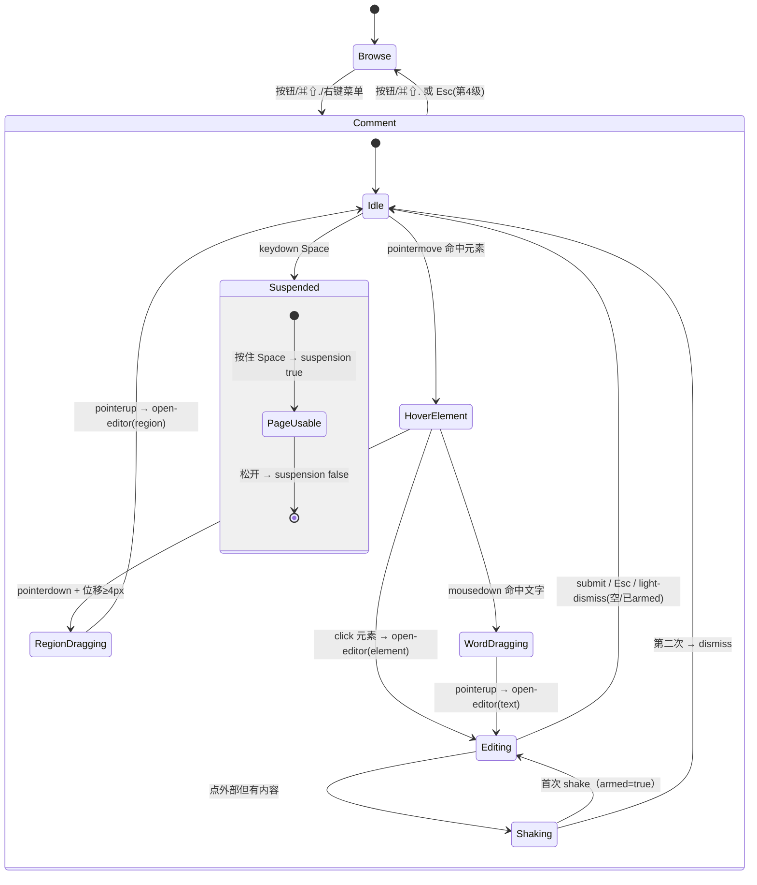

# Codex 桌面端「浏览器元素 / 文字选择 + 批注」交互逆向拆解

- 目标：`/Applications/ChatGPT.app`，`CFBundleIdentifier = com.openai.codex`，版本 `26.1029.61003`（Electron / Chromium，asar 内 `browser-page-preload.js` + webview 异步 chunk）。
- 目的：为 Nudge 的交互/视觉升级提供**可落地的事实基线**，并纠正若干流传中的错误假设（见 §0.2）。
- 方法：静态 JS/CSS 逆向（行号引用）+ 本机真实截图观察。**没有**运行目标、没有 hook 运行时、没有改动机器上任何应用或源码。

> 证据置信度标记：
> **[S]** 静态代码已证实（可复核行号）
> **[O]** 截图观察（本机截图，主观但可直接核对）
> **[I]** 推断（由 [S] 组合出的行为/意图，未运行验证）
> **[U]** 未知（已明确列出待验证项，不臆测）

---

## 0. TL;DR（10 条，先看这里）

1. **[S] 两种"模式"是正交的**：`interactionMode ∈ {browse, comment}` 是面板级状态；`annotationEditorMode ∈ {comment, design}` 是批注编辑器风格。**没有**独立的 "annotate/edit" 模式切换（≠ 本插件 `browse|annotate|edit` 三态）。证据：`135892.62a56063a9.pretty.js:7072-7095`、`browser-page-preload.pretty.js:33109-33124`。
2. **[S] 光标即交互语义**：批注模式下页面原生光标被 `html, body, body * { cursor: none !important }` 全局干掉，改画 26×26 的自定义光标；主光标是**加号 `+`**（多选能力开启时），文字上是**带气泡的 I-beam**。证据：`browser-page-preload.pretty.js:15575-15620`、`20243-20260`、`25263-25265`。
3. **[S] Space 是"把页面交还给用户"的临时开关**，实现为 **preload → 主进程 → webview 回同步** 的往返（`annotation-suspension`），不是纯本地行为。证据：`browser-page-preload.pretty.js:23343-23379`、`23338`；文案证据：`135892:1896-1902`。
4. **[S] click 与 drag 的分界是 4px**（`dragThresholdPx: 4`，另有一处 `E.we(start, current, 4)`）。证据：`browser-page-preload.pretty.js:21685`、`19488-19497`。
5. **[S] 选区高亮用 CSS Custom Highlight API**：`::highlight(codex-browser-text-selection)`，色值 `#128dff66`；拖选过程中还会把原生 `::selection` 设成透明（`background-color: transparent !important`）。证据：`browser-page-preload.pretty.js:25842-25843`、`26200-26212`。
6. **[S] marker（编号气泡）是 26×26、`border-radius: 50% 50% 50% 3px`**，白色 1.65px 描边，锚点在**气泡左下角**（`translate(0,-100%)`），悬停 `scale(1.08)`；重叠 marker 以 **12.5px** 为步长水平扇开，安全内缩 **29px**。证据：`20300-20309`、`20051-20090`、`14534-14565`、`19487`。
7. **[S] 动画 token 统一为 `150ms cubic-bezier(.23,1,.32,1)`**，且在源码里就是命名 token `--ease-enter-snappy: cubic-bezier(.23, 1, .32, 1)`。证据：`20241`、`webview/assets/async/361a1f04b890.css`（`--ease-enter-snappy`）。
8. **[S] 覆盖层是 Shadow DOM + 原生 `popover="manual"` top-layer**，宿主 id `codex-browser-sidebar-comments-root`，`z-index: 0x7fffffff`；同时把宿主重新挂回 `documentElement` 防止站点把 root 删掉/重置。证据：`14724-14726`、`20765-20800`、`15627-15700`、`20515-20544`。
9. **[S] 轻关闭是「两段式」**：内容为空 → 直接关；有未保存内容 → 先 **shake** 并把 `armed` 置真，第二次才关闭。策略函数为 `(design && reason!=="outside") || lightDismissible || armed ? "dismiss" : "shake"`。证据：`476181.839c977b97.pretty.js:46-57`、`802294.7d302c0378.pretty.js:1445-1450`、`1490-1512`、`2086-2103`。
10. **[S] 切换模式的默认快捷键是 `CmdOrCtrl+Shift+.`**（仅 electron 可用，`shortcutScope:"app"`）。证据：`app.asar` 字节偏移 `6577455`（命令注册表），见 §7.3 复现命令。

### 0.2 需要纠正的三个假设

| 假设 | 实际证据 | 结论 |
| --- | --- | --- |
| "composer 26px 圆角" | 评论卡片是 `rounded-[22px]`（`802294:2793-2794`）；**26px 是 marker/cursor 的尺寸常量**（`E.mC.width = 26`，`browser-page-preload:14428`） | 圆角 22px；26px 属于 marker/光标 |
| "browse / annotate toggle" | 是 `browse/comment` 两态 toggle（`135892:8876-8905`），编辑器风格另算 | 不要实现成三态并列 |
| "文字选择是自绘选区" | 是**原生 selection + CSS Custom Highlight 上色**；自己只画 overlay rect 和自定义光标 | 不要自己实现文字命中 |

---

## 1. 证据与方法

### 1.1 证据清单

| 代号 | 路径 | 内容 | 规模 |
| --- | --- | --- | --- |
| **P** | `/tmp/codex-extract/browser-page-preload.pretty.js` | 注入到被浏览页面的 preload 运行时（覆盖层/光标/选区/消息桥/站点 API） | 34,200 行 |
| **T** | `/tmp/codex-extract/135892.62a56063a9.pretty.js` | webview 应用里的浏览器工具栏、批注按钮、coachmark、命令注册 | 15,742 行 |
| **C** | `/tmp/codex-extract/802294.7d302c0378.pretty.js` | 浮动评论编辑器（独立 popup 窗口） | 2,850 行 |
| **D** | `/tmp/codex-extract/476181.839c977b97.pretty.js` | 提交/轻关闭决策纯函数 | 约 300 行 |
| **CSS** | `/tmp/codex-extract/webview/assets/async/361a1f04b890.css` | webview 全量 CSS（含 `--ease-enter-snappy`、`annotation-mode-label`） | 1.2 MB |
| **ASAR** | `/Applications/ChatGPT.app/Contents/Resources/app.asar` | 命令注册表 / 默认键位 | 688 MB |
| **IMG-1** | `/Users/purity3/.dsh/attachments/v1/objects/6f/6f8b6c1dda33db31a2db8ebc80810b1a0e1a63934282be7665ee60d2963e481b` | 文字选择 + 编号 marker + 底部批注条 | 1357×766 |
| **IMG-2** | `/Users/purity3/.dsh/attachments/v1/objects/60/60772fadddaf9513a0fc47c986fa90f0f9fa65558e489c6c5493d1ffd1ababa3` | 元素选择框 + 浮动评论输入条 | 975×1068 |
| **IMG-3** | `/Users/purity3/.dsh/attachments/v1/objects/a9/a9f7704b14d5f73698eaeec0326007296ff361bdb7465270cea8b0f964f005b2` | 样式编辑（design）弹层 | 554×509 |

> 三张截图含用户数据，**只在本机引用，不复制进仓库**。`docs/evidence/` 里的既有截图属于本插件，未经确认不可混用。

### 1.2 复核方式（可执行）

```bash
# 核心样式与 token
sed -n '20241,20310p' /tmp/codex-extract/browser-page-preload.pretty.js
# Space / Esc 状态机
sed -n '23330,23400p;24145,24210p' /tmp/codex-extract/browser-page-preload.pretty.js
# 轻关闭策略
sed -n '46,57p' /tmp/codex-extract/476181.839c977b97.pretty.js
# 批注按钮 + coachmark
sed -n '1780,1960p' /tmp/codex-extract/135892.62a56063a9.pretty.js
# 默认快捷键（命令注册表）
dd if=/Applications/ChatGPT.app/Contents/Resources/app.asar bs=1 skip=6577455 count=340 2>/dev/null
```

---

## 2. 运行时拓扑

### 2.1 三层 + 一个独立窗口

```
┌──────────────────────────────────────────────────────────────────┐
│ Electron main（app.asar）                                        │
│  · 窗口 / webview 生命周期 / capturePage 截图 / 窗口 bounds       │
└───────────────┬──────────────────────────────┬───────────────────┘
   ipc           │                              │ ipc
┌───────────────▼─────────────┐   ┌────────────▼───────────────────┐
│ webview 应用（T=135892）     │   │ 被浏览页面                     │
│  · 工具栏 / 批注按钮 / URL   │   │  预加载 preload（P）           │
│  · 浏览器侧边栏状态机        │   │  · Shadow DOM 覆盖层           │
│  · 命令注册 + 快捷键         │   │  · 自定义光标 / marker / 高亮  │
└─────────────────────────────┘   │  · document.oai.annotation API │
                                  └────────────┬───────────────────┘
                                               │ window.open("about:blank")
                                  ┌────────────▼───────────────────┐
                                  │ 评论编辑器独立 popup 窗口（C）  │
                                  │  · portal 挂载 / 复制样式表     │
                                  └────────────────────────────────┘
```

**[S]** preload 直接 `require("electron")`：`browser-page-preload.pretty.js:32166`；用 `ipcRenderer` 收发全部运行时消息：`33247-33296`、`33381`、`33957`、`34124`、`34157-34191`。
**[S]** 编辑器不是页面内元素，而是 `window.open("about:blank", frameName, "popup=yes,left=…,top=…,width=…,height=…")` 的**真实子窗口**，再 `createPortal` 进去：`802294:1594-1596`、`2790-2830`。
**[O]** IMG-2/IMG-3 中"浮在元素上的卡片"就是这个子窗口的内容——所以它能**超出页面边界**、不被 `overflow:hidden` 裁掉。

### 2.2 页面侧覆盖层：Shadow DOM + top-layer popover

**[S]** 宿主节点创建（`20765-20800`）：

```js
// 20765-20800（节选）
let e = document.getElementById(tx.b5);            // "codex-browser-sidebar-comments-root"
let t = document.createElement("div");
t.id = tx.b5;
t.style.position = "fixed"; t.style.inset = "0";
t.style.pointerEvents = "none";
t.style.zIndex = String(0x7fffffff);               // 2147483647
document.documentElement.appendChild(t);
let o = n.shadowRoot ?? n.attachShadow({ mode: "open" });
```

- **[S]** 常驻 `MutationObserver` 监听 `document` / `documentElement`，一旦 root 被站点移除就重新 append，并重新 `showPopover()`：`15627-15692`。
- **[S]** 交互层是 `popover="manual"` 的 `div.interaction-layer`（`20515-20544`），并逐帧确认 `showPopover` 成功（`q4 → k`，`15672-15700`）。
- **[S]** `popover` 里还有一个 `div.interaction-blocker`：`position:absolute; inset:0; pointer-events:auto; touch-action:pan-x pan-y`，用于截图/覆盖时**吃掉**页面指针事件（`20283`、`20546-20550`、`25354`）。
- **[S]** 覆盖层内容 `pointer-events:none`，只有 marker 与 interaction-layer 可点：`20281`、`20300-20301`、`25310-25312`。

**[I]** 选择 Shadow DOM + top-layer 的原因很明确：绕开站点的 `transform` / `overflow` / `z-index` 层叠上下文，同时把 `popover` 放到浏览器 top layer，天然压过所有 fixed 元素（Modal、弹窗、toast）。本插件已用 Shadow DOM（`src/runtime/inspector-runtime.js:832-835`），但**没有**用 `popover="manual"`。

### 2.3 状态同步：快照 + 命令消息，双向

**[S]** 页面 preload 维护一份 `V` 状态快照（`33109-33124`），由 `browser-sidebar-runtime-sync` 整体覆盖（`33265-33330`）：

```
interactionMode, annotationEditorMode, isAgentControllingBrowser,
canUseTweaks, canUseAnnotationMultiSelect, isDesignModifierPressed,
areAnnotationMarkersVisible, isAnnotationSuspended, isTweaksEditorOpen,
comments[], intlConfig, viewportScale, zoomPercent,
siteAnnotationFeaturesEnabled
```

**[S]** webview 侧向上游 `browser-sidebar-sync` 时还会带：`annotationModeEnabled`、`annotationModeLabels`、`emulatedViewportSize`、`viewportScale`、`topContentInset`、`themeVariant`、`runtimeIntlConfig`、`hostKind`（`right-panel`/`bottom-panel`）、`pagePersistence`、`mountGeneration` 等（`135892:6250-6282`）。

**[S]** 页面侧对消息做了**缓冲**（`q`，`33128-33200`）：`sync`、`capture-text-selection`、以及 6 个"打开/恢复编辑器"类消息在 runtime 尚未 mount 时先入队，mount 后 `flush`；编辑器类消息只保留**最后一条**。这是一个值得抄的健壮性设计。

---

## 3. 交互状态机

### 3.1 模式模型

| 维度 | 取值 | 默认 | 证据 |
| --- | --- | --- | --- |
| `interactionMode` | `browse` \| `comment` | `browse` | P:33109-33124；T:7072-7095 |
| `annotationEditorMode` | `comment` \| `design` | `comment` | T:7091；P:33113-33124 |
| 多选能力 | `canUseAnnotationMultiSelect` | 宿主下发 | P:21709-21711 |
| 文字选择 | 由覆盖层内部 `et`（文字选择交互开启）派生 | — | P:21710-21713、25263-25265 |

**[S]** `comment` 模式下覆盖层"接管"页面；`browse` 模式下**整个交互层不渲染**（`(!eb || tc) && (tu || eS ? <popover layer> : <fragment>)`，`24995-25010` 附近，实际在 `25494-25495`）。
**[S]** `isAnnotationSuspended`（Space / 站点请求 / 编辑器接管）会直接卸载交互层（`eb = "comment"===ev && isAnnotationSuspended`，`21707-21708`）。

### 3.2 总状态表（可直接对照实现）

| # | 触发 | 前置守卫 | 效果 | 证据 |
| --- | --- | --- | --- | --- |
| 1 | 点击工具栏「Annotate」/ `⌘⇧.` / 右键菜单 | `isAnnotationModeEnabled`、非 agent 控制、tab 可批注 | `interactionMode → comment`，记录 `annotationModeEntrySource`，按 `focusMode` 聚焦网页 | T:8876-8905、T:7072-7115 |
| 2 | 再次触发 / `Esc` 在无编辑器时 | 同上 | `interactionMode → browse`，发 `browser-sidebar-runtime-exit-comment-mode` | T:8876-8905；P:24192-24203 |
| 3 | `pointerdown` 在元素上 | `comment` 模式、未按住 `suspended`、非标注容器 | 进入候选元素选择（`z.current`），准备 click/drag 判定 | P:23730-23810 |
| 4 | `pointermove` 位移 ≥ **4px** | 已 pointerdown | 升格为 region 拖选（`isDraggingRegion`），画 marquee | P:19488-19497 |
| 5 | `pointerup` 区域 | `isDraggingRegion && rect` | 发 `open-editor(mode:create, anchor.kind=region, wantsScreenshot)` | P:23521-23532 |
| 6 | `pointerup`/`click` 元素 | 未 drag、非多选追加 | 选中元素并打开编辑器（anchor.kind=element） | P:23881-24010 |
| 7 | `mousedown` 落在文字上 | 文字容器命中 | `startWordDrag()`：清空原生选区 → 选中该词 → 进入词级拖选 | P:23730-23755、21580-21610 |
| 8 | 词级拖选移动 | 已 startWordDrag | `wordDrag(range, point)` 扩选；`preventDefault` | P:21625-21650 |
| 9 | 词级拖选抬起 | — | `textLocator` 提取 → `open-editor(anchor.kind=text)` | P:21655-21685、23770-23780 |
| 10 | 按住 **Space** | `comment` 模式、无编辑器、焦点不在输入控件 | 捕获按键 → 发 `browser-sidebar-runtime-annotation-suspension {suspended:true}` | P:23343-23379 |
| 11 | 松开 **Space** | 之前捕获过 | 再发 `{suspended:false}` | P:23366-23379、23386-23400 |
| 12 | 按住 **Shift** 并 hover | `canUseAnnotationMultiSelect && anchor.type!=="virtual"` | 光标变 `+`，高亮"可追加"；点击追加到 `additionalSelections` | P:25160-25220、23629-23639、23920-23945 |
| 13 | `Esc` | 见 §3.6 四段式 | 取消 drag / 清区域 / 关编辑器 / 退出批注模式 | P:24169-24195 |
| 14 | marker `mouseenter` | 无编辑器 | 发 `open-comment-preview`，画对应锚点高亮 | P:25460-25472、22112-22130 |
| 15 | marker `click` | 无编辑器 | 关 preview → 发 `open-editor(mode:edit, commentId)` | P:25472-25488、22004-22090 |
| 16 | 编辑器内点击外部 | 见 §3.7 | `dismiss` 或 `shake` | D:46-57；C:2086-2103 |

### 3.3 browse / comment 切换的宿主侧细节

**[S]** 切换函数（`135892:8798-8820`）：

```js
// tN = setInteractionMode
let r = mode === COMMENT ? null : { fromSnapshot: getSnapshot(browserTabId, conversationId) ?? EMPTY_TAB, to: mode };
flushSync(() => sq(r));
if (focusMode === "focus") requestAnimationFrame(() => rootRef.current?.focus());
```

- 进入 `comment` 时**不**写过渡快照；退出时写入 `to: BROWSE` 的快照（用于退出后恢复 tab 展示）。
- `focusMode` 只有两个值：进入 `"focus"`（把焦点交给 webview），退出 `"none"`（`135892:7094-7095`）。

**[S]** 入口来源枚举（用于埋点 + 首次 coachmark 触发策略）：`toolbar-button`、`keyboard-shortcut`、`context-menu-annotate`、`context-menu-quick-annotate`（`135892:1612-1617`、`7100-7115`）。
**[S]** 工具栏按钮属性：`aria-label="Annotate this page"`、`label="Annotate"`、`aria-pressed`、`variant:"annotation"`、`responsiveLabel`（`135892:1789-1860`）。

### 3.4 click vs drag region

**[S]** 拖拽管理器用 `dragThresholdPx: 4`（`21685`）；区域判定 `tB()` 用 `E.we(start, current, 4)`（欧氏距离任一轴 ≥4px，`19488-19497`、`14655-14657`）。
**[S]** 双击容错：`Math.hypot(...) > 5` 视为移动（`23697`、`23716`）；单击判定还要求 `performance.now() - timeStamp <= 500`（`23696`）。
**[I]** 4px 阈值 + 500ms 双击窗口的组合意图：触控板轻点不会误判成拖选；连点两次是"进入编辑/追加"而不是"取消"。

### 3.5 Space：把页面临时交还给用户

这是整套交互里最容易做错、也最值得抄的一点。

**[S]** 按键判定（`23343-23379`，节选并还原命名）：

```js
ti = (e) => {
  e.isTrusted && e.code === "Space" && e.type === "keydown" && !e.repeat && (spaceHeld.current = false);
  const held = spaceHeld.current && e.code === "Space";
  if (interactionMode !== "comment" && !held) return;
  const captured = (function (e, held, { preserveTyping }) {
    if (!e.isTrusted || e.code !== "Space") return;
    if (!held && (e.isComposing || e.altKey || e.ctrlKey || e.metaKey || e.shiftKey ||
        (preserveTyping && e.composedPath().some(isEditableish)))) return;
    e.preventDefault(); e.stopImmediatePropagation();
    return e.type === "keydown";           // keydown → true, keyup → false
  })(e, held || suspended || hostSuspended, { preserveTyping: pathHasComposerish(e) });
  if (captured != null) { spaceHeld.current = captured; to(captured); }
};
```

关键点：
1. **`e.repeat` 时不再重置**，所以长按 Space 会持续吞掉自动重复的 keydown（避免页面因空格滚动）。
2. 只在"第一次按下"时检查输入法/修饰键/可编辑目标——之后必须持续吞 keyup，否则页面会收到半截按键。
3. `to(n)` 只在**状态变化**时向宿主发 `browser-sidebar-runtime-annotation-suspension {suspended}`（`23338-23342`）。
4. 真正的"交还"发生在宿主把 `isAnnotationSuspended` 同步回来之后：`eb=true` → 交互层**整层卸载**（`25494-25495`），页面恢复原生 `cursor`/点击/选择。

**[S]** 这是"往返"而不是本地设置——从 `to` 的定义可见它只发消息：`23338-23342`；本地状态 `es.current/ec.current` 仅用于判断"是否已经捕获"。
**[S]** 按钮 tooltip 明确写了语义：**"Click anywhere to annotate, or drag to select an area. Hold `<key>`Space`</key>` to temporarily use the webpage."**（`135892:1896-1902`）。

**对比本插件**：`src/runtime/inspector-runtime.js:1976-2002` 的 Space 处理是**纯本地** `setPassthrough(true)`，且只在 `mode !== 'browse'` 时生效。它有 `isEditableTarget(event.target)` 守卫（在页面输入框里按空格不会被吞，这一点是对的），但相比 Codex 缺三件东西：（a）`isComposing` 与修饰键守卫；（b）`stopImmediatePropagation` —— 站点只要在更早的 capture 阶段 `stopPropagation`，插件就完全收不到 Space；（c）宿主同步 —— 宿主与站点都无法感知「用户正在临时使用页面」。也就是说插件是「被动守卫」，Codex 是「主动接管」。

### 3.6 Esc：四段式，从最内层往外收

**[S]** `24169-24195`（`keydown` 捕获阶段；语义还原，非逐字）：

```js
if (e.key === "Escape" && e.isTrusted) {
  if (D.current?.clear(), eg.cancel()) { e.preventDefault(); suppress(); return; }  // 1. 取消词级拖选
  if (dragSelection) { suppress(); clear drag; return; }                              // 2. 取消区域拖选
  if (editor && (editor.target.mode === "create" || hostExitRequested) && editor.anchor.type !== "text") {
    e.preventDefault(); cancelEditor(editor); return;                                  // 3. 关创建态编辑器
  }
  if (!editor && interactionMode === "comment") {
    e.preventDefault();
    sendMessageToHost({ type: "browser-sidebar-runtime-exit-comment-mode" });          // 4. 退出批注模式
  }
}
```

要点：`Esc` 是"逐层收"，且**第 4 级才退出整个模式**；文字锚点的编辑器要由宿主来决定关不关（`anchor.type !== "text"` 才本地关）。

### 3.7 轻关闭（light dismiss）与 shake

**[S]** 策略纯函数（`476181.839c977b97.pretty.js:46-57`）：

```js
function dismissAction({ targetMode, reason, isLightDismissible, isLightDismissArmed }) {
  return (targetMode === "design" && reason !== "outside") ||
         isLightDismissible || isLightDismissArmed
    ? "dismiss"
    : "shake";
}
```

**[S]** 两个布尔量的来源：
- `isLightDismissible`（`tr.current`）= `target.mode === "edit"` **或**（注释正文为空 且 无附件）→ `802294:1716-1722`。
- `isLightDismissArmed`（`tn.current`）：首次 dismissed 失败时置真（`1490-1512`、`2086-2103`）。

**[S]** 失败分支动作：`armed=true; setShake(true); 重排(tA); shake()`。`shake` 来自 `v.y()` hook（`802294:1374`）。
**[S]** 触发来源有区分：`reason ∈ {"outside","escape","exit"}`；`design` 模式下 `escape/exit` 无条件关闭，`outside` 仍走 shake 逻辑（`476181:53`）。

**[I]** 设计意图：编辑已有评论/没有未保存内容 → 外界点击就关；一旦有草稿，第一次点击"只是警告"（抖动），第二次才真正丢弃。这是比"直接关闭"更安全的 UX，**强烈建议照抄**。

### 3.8 文字选择

**[S]** 三条并行机制：

1. **命中**：`caretPositionFromPoint` + `range.expand("word")`（`25924-25950`）用于点选单词；拖选过程 `wordDrag(range, point)` 扩展（`25951-25990`）。
2. **选区**：直接用浏览器原生 `Selection`（`getSelection().removeAllRanges(); addRange(...)`，`21606-21612`），因此在输入框（`input/textarea` 的 `selectionStart/End`）和普通 DOM 上都能工作（`25853-25920`）。
3. **上色**：`CSS.highlights` + `new Highlight(range)` + `::highlight(codex-browser-text-selection) { background-color: #128dff66 !important }`，并把样式表 `adoptedStyleSheets` 注入到**选区的 root**（含 shadow root）：`25730-25760`。
   - 拖选进行中还额外注入 `::selection { background-color: transparent !important; color: currentColor !important; }`，让原生蓝色被自定义高亮取代（`26200-26212`）。
   - 拖选临时高亮名为 `codex-browser-text-selection-drag`（`26201`）。

**[S]** 文字锚点的序列化（`textLocator`）字段：`kind: "dom" | "form-control"`、`direction`、`rangeText`、`selector`、`shadowHosts[]`、`startOffset`、`endOffset`、`selectionRects[]`（`14593-14630` 的相等性比较即字段清单）。
**[S]** 上限：选中文本 ≤ `2e4`（20,000）字符（`E.o3`，`26245-26252`）；超过直接放弃，不打开编辑器。

**[I]** 为什么不用自绘选区：`Selection` 天然处理 bidi、软换行、`::first-letter`、表格、内容可编辑区；自绘只能近似。本插件完全没有文字选择能力——这是差距最大的一块。

### 3.9 Shift 多选

**[S]** 能力开关：`canUseAnnotationMultiSelect && anchor.type !== "virtual"`（`21709-21711`）。
**[S]** 修饰键状态 `ed.current`（"annotation selection modifier active"）：
- `pointerdown` 时 `shiftKey && !ed.current` → `ed.current = true`，并发 `browser-sidebar-runtime-annotation-selection-modifier-state {pressed:true}`（`23629-23639`）。
- `keyup` 且 `!shiftKey` → `ed.current = false` 并复位光标（`24147-24149`）。
- `keydown`/`keyup`/`mousemove`/`blur` 全局监听维护 hover 点 `G.current`（`23380-23400`）。

**[S]** 追加语义：`update-anchor` 消息携带 `anchor.additionalSelections[]`（`22880-22930`、`22930`）；覆盖层渲染时把 primary + additional 一起画（`24970-25000`、`25100-25120`）。
**[S]** 命中/删除提示：`annotation-selection-linked-hover` / `annotation-selection-remove-hover` 两个类名（`20392-20402`、`25256-25260`），即 hover 到已选项会显示"将移除"态。
**[S]** `[data-browser-comment-annotation-selection-modifier-active] .marker { cursor: none }`：修饰键激活时 marker 不再显示手型（`20293`）。

### 3.10 marker hover / click

**[S]** marker 是 `<button>`，可键盘聚焦（`aria-label` 由 i18n `browserSidebarCommentRuntime.commentMarkerLabel` 提供，含编号，`20219-20226`、`20407-20425`）。
**[S]** hover：`onMouseEnter` → 关闭条件（截图捕获中 / 已有编辑器打开）→ `eV(comment, anchor, index)` 发 `open-comment-preview {commentId, anchorState}`，同时本地 `b(id)` 高亮（`22112-22130`）。`onMouseLeave` → 发 `close-comment-preview`（`22940-22965`）。
**[S]** 草稿 marker（未保存）单独一条消息路径：点击发 `browser-sidebar-runtime-focus-editor`（`25420-25440`）。
**[S]** `onMouseDown: e.preventDefault()` 防止抢焦点（`20414`）。

### 3.11 coachmark

**[S]** 文案与几何（`135892:1928-1952`）：

| 字段 | 值 |
| --- | --- |
| 标题 | `thread.browser.commentModeCoachmarkTitle` = **"Try Annotation Mode"** |
| 正文 | `thread.browser.commentModeCoachmarkDescription` = "Leave visual comments for ChatGPT with a single click or drag to select an area" |
| 位置 | `side: "end"`，`updatePositionStrategy: "optimized"`，`size: "wide"` |
| 触发 | `showCoachmark && !disabled && 按钮已测量出非零尺寸`（`ee = z && !j && Y != null`，`1694-1706`） |
| 关闭 | `onDismissCoachmark`，持久化键 **`browser-sidebar-comment-mode-coachmark-dismissed`**（`802294:1285-1292`） |

**[S]** 按钮自身的 tooltip（未激活态）走 `p.h` 组件；激活态用带 Space 键帽的说明（§3.5）。
**[I]** coachmark 是"一次性教学"，与首次进入批注模式解耦：只要没 dismiss 过就一直挂着（`d = isEnabled && !dismissed`）。

### 3.12 状态机图（整理版）



---

## 4. 视觉规格

全部数值来自静态代码/ CSS，可直接照抄。

### 4.1 选择框 / 高亮 / 区域

| 元素 | 规格 | 证据 |
| --- | --- | --- |
| 元素 hover / 选中框 | `border: 2px solid #0069FB`；`background: color-mix(in srgb, #0069FB 3%, transparent)`；`box-shadow: inset 0 0 0 1px rgba(255,255,255,.28)`；`border-radius: 0`（默认，元素有圆角时用快照 `borderRadius`）；`pointer-events:none` | P:20276、20294-20296 |
| 元素框 hover 加深 | `border-color: color-mix(in srgb, #0069FB 80%, black)` | P:20294 |
| 区域框（拖选 / 已发布） | `border: 2px dashed #0069FB`（`.region-box`）；已发布区域 `background: 3%` | P:20298、20299、20276 组合 |
| 文字选择高亮（自定义） | `background: #128dff66`（≈40% 透明蓝）；`::highlight(codex-browser-text-selection)` | P:20279、25842-25843 |
| 拖选/追加的临时矩形 | `.text-selection-highlight`，同色，逐 rect 渲染 | P:20279、25377-25385 |
| flex 子项 overlay（design scrub） | `border: 1px solid rgba(2,133,255,.52)`；`background: rgba(18,141,255,.18)`；`inset 0 0 0 1px rgba(255,255,255,.12)` | P:20280 |
| Google Docs 特例 | 去掉背景/阴影/边框（`google-docs-annotation-box` / `-element-box`） | P:20297-20299 |

**[O]** IMG-2 可核对：选中块是**细蓝实线、几乎无填充**；IMG-1 可核对：文字选区是**浅蓝底色**、marker 是**蓝底白字圆气泡**。与代码一致。

### 4.2 自定义光标

**[S]** 尺寸与热点（`P:14428`）：

```js
v = { width: 26, height: 26, hotspot: { x: 0, y: 26 } };   // E.mC
// 热点表（P:20246-20250）
hotspotByMode = {
  add:     { x: 13,    y: 13   },   // 居中
  comment: { x: 0,     y: 26   },   // 左下角
  text:    { x: 7,     y: 13.5 }    // I-beam 中心
}
```

| 模式 | 图形 | 颜色 | 证据 |
| --- | --- | --- | --- |
| `add`（主光标，多选开启时） | 20×20 viewBox 的加号，缩放到 26 | `color:#000` + `stroke:white; stroke-width:2px; paint-order:stroke fill`（黑加号白描边） | P:20311-20320、20285 |
| `comment` | 带左下尾巴的圆气泡（`M e/2 r a… H3 a3 3 0 0 1 -a -a V t/2 …`） | `fill:#339cff`；`stroke:white`；`stroke-width:1.65` | P:20243-20260、20330-20360 |
| `text` | 气泡 + I-beam（`beam` 路径） | 气泡缩到 `scale(.55)` 并平移；I-beam `opacity:1` | P:20288-20292、20338-20360 |

**[S]** 定位公式（`25364-25372`）：`left = point.x * zoom - hotspot.x * scale`，`top = point.y * zoom - hotspot.y * scale`；`scale = 1 / viewportScale`（`E.cn`，`14430-14431`）。
**[S]** 光标元素只在"无编辑器 / 创建态非文字"时渲染（`25356-25364`），且 `pointer-events:none`。

**[S]** 隐藏原生光标（`15575-15620`）：向**每个 document** 注入

```css
html, body, body *, #codex-browser-sidebar-comments-root, #codex-browser-sidebar-comments-root * { cursor: none !important; }
```

- 普通模式额外加 `user-select: none !important`（防止拖出原生选区）。
- **文字选择模式**只保留 `cursor:none`，并直接给指针下的元素 `style.setProperty('cursor','none','important')`（带原值恢复），这样原生 selection 照常工作（`15563-15603`）。
- 退出时删除 style 并恢复所有被改写的元素（`15605-15625`）。

**[S]** reduced-motion：光标气泡 transform / beam opacity 的 150ms 过渡在 `prefers-reduced-motion: reduce` 下禁用（`20292`）。

**对比本插件**：`src/runtime/inspector-runtime.js:710-721` 已注入 `cursor:none`，但（a）**没有** `user-select:none`，所以拖拽会选中页面文字；（b）**没有**逐元素 cursor 覆盖，遇到 `!important` 的站点光标可能漏；（c）**没有** iframe / shadow root 遍历；（d）光标图形是 26px 盒内约 24.35px 直径的气泡（`936-940`），热点计算 `top - 26` 与 Codex 的 `(0,26)` 一致（`776-788`）；但插件在贴近视口边缘时会整体翻转（`flipX/flipY`），Codex 不翻转、保持锚定。

### 4.3 marker（编号气泡）

| 属性 | 值 | 证据 |
| --- | --- | --- |
| 尺寸 | `26px × 26px`（`--browser-sidebar-saved-marker-size = 26 * (1/viewportScale)`）；草稿 marker 同尺寸 | P:25284-25293、14428 |
| 形状 | `border-radius: 50% 50% 50% 3px`（圆 + 左下尖角 = 气泡） | P:20051-20090 |
| 填充/描边 | `background: #339cff`（编号态）；描边由 SVG `stroke:white; stroke-width:1.65` 提供 | P:20071-20075、20258-20259 |
| 数字 | 白色、`font-weight:700`、`font-size: 11 * (1/viewportScale)` px、`line-height:1` | P:20306、25285 |
| 锚定 | `left/top = markerPoint`；`transform: translate(-0%, -100%)` → **气泡左下角**落在锚点上（向上、向右展开） | P:20261-20266、20301 |
| 交互 | `pointer-events:auto; cursor:pointer`；`onMouseDown preventDefault` | P:20301、20414 |
| hover / 选中 | `.marker-motion { scale: 1.08 }`，`transition: scale 150ms cubic-bezier(.23,1,.32,1)`，`transform-origin: bottom left` | P:20307-20308 |
| 编号来源 | `commentNumbersById = new Map(comments.map((c,i)=>[c.id, i+1]))` → **宿主评论数组顺序**，不是位置顺序 | P:21731 |
| 间距算法 | 同 `(round(x):round(y))` 的 marker 以 **12.5px** 步长水平扇开；`x_min=28.5`，`x_max=viewportWidth-16-12.5`；单点不动 | P:14534-14565（`E.fj`） |
| 安全内缩 | `tU = E.K1 + E.QH/2 = 16 + 13 = 29px`；marker 点被 clamp 到 `[29, width-29]`，并按 `29/zoom` 缩放 | P:19487、19600-19630 |
| 溢出可见性 | marker 点若落在锚点可见矩形之外 → 不渲染（`tX` 返回 `null`） | P:19608-19650 |
| 草稿 marker | 无数字时显示 `•`；`[data-browser-comment-text-selection-active] .draft-marker{opacity:0;pointer-events:none}` | P:20428-20450、20305 |

**[O]** IMG-1：marker 1 / 2 都是蓝底白字圆气泡、左下角对着被选中的词尾，与该规格一致。

**[I]** 扇开（12.5px）是为了「同一锚点有多条评论」时不叠死；29px 内缩是保证 26px 气泡不被视口裁一半。

### 4.4 hover metadata tooltip（元素标签/尺寸/颜色/字体）

**[S]** 结构（`P:14367-14431`、`20475-20515`）：

```css
.element-metadata-tooltip {
  position: fixed; z-index: 2;
  display: grid;
  grid-template-columns: minmax(56px, auto) minmax(0, 1fr);
  align-items: baseline;
  gap: var(--…-row-gap) var(--…-column-gap);   /* 3px 12px(×scale) */
  height: var(--…-metadata-height);            /* 72px(×scale) */
  border-radius: var(--…-metadata-radius);      /* 12px(×scale) */
  outline: 1px solid rgba(15,23,42,0.08);
  background: white; color: rgb(15,23,42);
  padding: 8px 10px;                            /* ×scale */
  font-size: 13px; line-height: 1.25;
  box-shadow: 0px 2px 4px -1px rgba(0,0,0,0.08);
  pointer-events: none;
}
/* dark */
@media (prefers-color-scheme: dark) {
  .element-metadata-tooltip { background: rgba(15,23,42,0.95); color: white; }
  .element-metadata-label { color: rgba(226,232,240,0.62); }
}
```

| 行 | 内容 | 字体/颜色 |
| --- | --- | --- |
| 1 | `tagName` + `size`（如 `article · 1200×420`） | tag `rgb(28,28,28)`；value monospace `rgb(15,23,42)` |
| 2 | `color` 标签 + 计算色值 | label `rgb(125,125,125)`，`text-transform: lowercase` |
| 3 | `font` 标签 + 字体族 | value 右对齐 monospace |

**[S]** 定位算法（`14433-14465`，`E.t1`）：`maxWidth = min(240*invScale, viewportW - 2*16*invScale)`；优先放锚点**上方** `y - 72 - 8`，放不下则放**下方** `y + h + 8`；`x` clamp 到 `[16, viewportW - maxWidth - 16]`（均乘 `1/viewportScale`）。

**[I]** 这是"信息密度优先"的 tooltip：定宽两列、右列值等宽字体、固定 72px 高。与本插件的 `parts.meta`（`minWidth 154 / maxWidth 250 / padding 7×9 / radius 8 / 11px`，`inspector-runtime.js:942-975`）是两种取向，Codex 的更"表格化"。

### 4.5 评论编辑器（独立 popup 窗口）

| 属性 | 值 | 证据 |
| --- | --- | --- |
| 承载方式 | `window.open("about:blank", name, "popup=yes,left,top,width,height")` + `createPortal` | C:1594-1596、2790-2830 |
| 根节点 | `#browser-sidebar-comment-popup-root`，`100vw/100vh`，透明背景 | C:1294-1296、1654-1690 |
| 卡片圆角 | **`rounded-[22px]`**（`isolate`） | C:2793-2794 |
| 卡片背景 | `bg-surface-elevated-secondary shadow-md` + 内描边 `outline-1 outline-border`（`mix-blend-multiply` 覆盖层） | C:2790-2830 |
| 字号 / 字体 | `--annotation-comment-font-size: 13px`；`-apple-system, BlinkMacSystemFont, "SF Pro Text", "SF Pro", "Segoe UI", sans-serif` | C:2729-2733、2755-2760 |
| 行高 | `leading-6`（24px） | C:2755-2762 |
| 弹入/收起 | `transition-[opacity,transform] duration-[180ms] ease-enter-snappy`；收起态 `translate-y-1 opacity-40` → `translate-y-2 opacity-0` | C:2259、2063-2075 |
| 位置跟随 | `transition-[left,width,top,bottom] duration-[140ms] ease-enter-snappy` | C:2729 |
| reduced motion | `motion-reduce:transition-none` | C:2259、2729 |
| 尺寸来源 | 宿主下发 `overlayWindowBounds`、`maxSurfaceWidth/Height`、`reservedTrayHeight`、`metadataHeaderHeight` | C:1592、2304-2307 |
| 设计态浮层 | 截图 IMG-3：深色卡片、`取消` + 圆形白色提交按钮、逐属性行 | **[O]** |

**[S]** 暗色来自**应用主题 token**（`surface-elevated-secondary` = `light-dark(var(--gray-50), var(--gray-400))`，CSS:），不是页面 `prefers-color-scheme`。**[O]** IMG-1/IMG-2/IMG-3 中页面是浅色、编辑器却是深色，与"跟随应用主题"一致。

### 4.6 动效

| 用途 | 值 | 证据 |
| --- | --- | --- |
| 全局 easing token | `--ease-enter-snappy: cubic-bezier(.23, 1, .32, 1)` | CSS |
| 覆盖层数值常量 | `nz = [0.23, 1, 0.32, 1]` | P:20241 |
| hover 框显隐 | `opacity 150ms` | P:20276 |
| 光标气泡/beam | `transform 150ms` / `opacity 150ms` | P:20288-20290 |
| marker hover | `scale 150ms`，`1 → 1.08` | P:20307-20308 |
| 草稿 marker | `opacity 150ms` | P:20304 |
| 编辑器弹入 | `160ms`（插件）/ `140ms/@180ms`（Codex popup 窗口） | P:20288 vs C:2259/2729 |
| reduced-motion | 上述 transition 全部 `none` | P:20278、20292、20309；C:2259、2729 |

**[S]** 本插件已定义同名常量 `MOTION = '150ms cubic-bezier(0.23, 1, 0.32, 1)'`（`inspector-runtime.js:27`）——**这一项已经对齐**，只是缺少 Codex 那种"0.55 缩放的文字态光标"和 marker 扇开动画。

### 4.7 light / dark token 对照

| 层 | 浅色 | 深色 | 来源 |
| --- | --- | --- | --- |
| 页面覆盖层（hover 框 / marker / 光标） | `#0069FB` / `#339cff` / `#128dff66` **固定** | 同值（不随主题变） | P:20241-20260 |
| metadata tooltip | `white` + `rgb(15,23,42)` | `rgba(15,23,42,.95)` + `white` | P:14367-14431（media query） |
| marker 数字 | `white`（`nL.stroke`） | 同 | P:20306 |
| 编辑器卡片 | `--color-surface-elevated-secondary` = `light-dark(--gray-50, --gray-400)` | 由应用主题决定 | CSS；C:2793 |
| 主题值 | `themeVariant` 由宿主下发，页面 `matchMedia` 兜底 | | P:19563-19568（`tq`）、20045 |

**[I]** 页面内所有强调色**不跟随页面暗色模式**是刻意为之：保证任意站点上 marker/选择框都有稳定可读性。这正是本插件用 `theme.accent` 会踩到的坑（站点深色页面时低对比）。

---

## 5. 工程与边界

### 5.1 iframe / 跨文档

**[S]** `elementFromPoint` 递归穿透 shadow root 与**同源 iframe**（`P:15495-15530`）：

```js
let i = t.document.elementFromPoint(n, r);
for (; i != null && i.shadowRoot; ) { let e = i.shadowRoot.elementFromPoint(n,r); if (!isEl(e)||e===i) break; i=e; }
if (isIframe(i)) { const w = i.contentWindow; if (w?.document) { const b = i.getBoundingClientRect(); return recurse(w.document, n-b.left, r-b.top); } }
```

**[S]** 枚举所有 frame：`y()` 广度遍历 `iframe` + shadow root（`15531-15560`）；`v(mount)` 给每个 document 装监听，`load`/`MutationObserver` 时重装（`15563-15620`）；坐标换算由 `Fw`/`Hi`/`vN` 等工具完成（`15290-15300`、`15355-15370`）。
**[S]** 文字选择态会把所有 iframe 的 `pointer-events` 临时设为 `none !important`，让指针事件回到顶层（`24733-24770`），并在清理时逐元素恢复原值。
**[S]** 退出时清掉所有 frame 的 selection（`26230-26245`）。

**对比本插件**：`inspector-runtime.js` 只在**当前 document** 工作（`doc = win.document`，`attachListeners` 只挂 `doc`/`win`），没有 iframe 处理，也没有 shadow root 的 `elementFromPoint` 穿透（只有选择器/path 解析支持 shadow）。

### 5.2 滚动容器 / 重排跟随

**[S]** 三套触发器同时挂（`24260-24340`）：
1. `window.resize`（capture）+ **所有 document 的 `scroll` 捕获**（`e.addEventListener("scroll", n, !0)`，`24282` 处 `r`）。
2. `MutationObserver`：监听 root document 与**所有 shadow root**（observer 配置 `tk`：`{attributes,childList,characterData,subtree}`，`19304`），在 attributes / 增删节点 / 新增 `[oai-annotation-container*]` 时重算（`24305-24345`）。
3. 滚动后 **100ms 防抖**（`em`）后才恢复 hover/tooltip，避免滚动中出现"跟不上的幽灵框"（`24272-24286`）。

**[S]** 每帧重算时如果锚点已失效（`LH` 返回 null）就降级：`placement:"top-left"`、`viewportRect:null`、`viewportPoint:{0,0}`（`19985-19995`），即"锚点丢了也还能显示编辑器，只是不指位"。

**[S]** 滚动容器也会被**记录**进锚点（`scrollContainers: [{selector, scrollLeft, scrollTop}]`，`14600-14615` 的比较逻辑、`23680-23700` 写入），用于跨会话恢复位置。
**[S]** 滚动容器识别：沿父链找 `overflow-x/y ∈ {auto,scroll,overlay,clip,hidden}` 且当前确实可滚动的元素（`14825-14890`、`24105-24130`）；Google Sheets 有专门的 `#waffle-grid-container .native-scrollbar-x/y` 特判（`24060-24095`）。

### 5.3 fixed 元素

**[S]** 锚点带 `isFixed`；坐标换算时 fixed 元素不加 `scrollY`（`19600-19630`、`15290-15300`、`15355-15370`）。反之非 fixed 要减 `scrollY`（以及跨 frame 的父滚动）。
**[S]** 区域选择固定 `isFixed:false`（`23870`），因为区域是视口坐标。

### 5.4 zoom / visualViewport

**[S]** `zoomPercent` → `eE = clamp(zoomPercent, 25, 500) / 100`（`Pf`，`14693-14696`；`21714`）。
**[S]** 覆盖层对 zoom 的补偿（`25272-25282`）：

```js
zoom !== 1 && (style = {
  height: `${100*zoom}vh`, width: `${100*zoom}vw`,
  transform: `scale(${1/zoom})`, transformOrigin: "top left"
});
```

即：**把覆盖层坐标空间放大到 zoom 倍，再整体缩回去**，这样覆盖层内部的 px 计算可以直接用页面 CSS px。
**[S]** `viewportScale` → `ek = 1/viewportScale`（`cn`，`14430-14431`），用于 marker / 光标 / tooltip 的尺寸与内缩（`25284-25293`），保证视觉尺寸恒定。
**[S]** 每次发消息都把 `visualViewport {offsetLeft, offsetTop, scale}` 附在 `anchorState` 上——**仅在确实发生缩放/偏移时才带**（`19666-19686`、`21488-21496`）。
**[S]** `visualViewport` 的 `resize`/`scroll` 也作为重排触发器（`21380-21400`、`22513`）。
**[S]** 页面 webview 限制缩放级别 `[1, 3]`：`o.webFrame.setVisualZoomLevelLimits?.(1, 3)`（`33529`）。

**[I]** 这三层（zoomPercent / viewportScale / visualViewport）分别对应：整页缩放、DPR/模拟设备缩放、移动端 visual viewport（键盘弹出、双指缩放）。本插件目前**完全没有**这三个概念——在 125%/150% 缩放下 marker 位置会偏。

### 5.5 截图

**[S]** 协议（页面侧）：
- 打开编辑器时带 `wantsScreenshot: true`（`23521-23532`）。
- 宿主下发 `browser-sidebar-runtime-prepare-comment-screenshot` / `-clear-comment-screenshot`；页面在 preload 的消息表里**显式忽略**（`33175-33181`），说明这两个消息由**webview 应用**消费。
- 页面在截图就绪时**主动回发**：

```js
// 25300-25315
{ type: "browser-sidebar-runtime-comment-screenshot-ready",
  commentId, annotationViewportRect, markerViewportPoint,
  ...(skip ? { skipScreenshotCapture: true } : {}) }
```

- 截图期间 `isScreenshotCaptureActive`：渲染 `interaction-blocker` 吃掉指针、隐藏 hover 框、只保留草稿 marker（`24980-25010`、`25310-25320`、`25354`）。
- 裁剪范围 `screenshotAnnotationViewportRect` = 文字 rects ∪ 高亮 rect ∪ 追加选区 rect 的并集（`25143-25158`）。

**[U]** 宿主侧 `capturePage` 的具体调用位置未在已提取 chunk 中找到（`T=135892` 内无 `capturePage` 字面量）。故**截图实现**（裁剪像素、DPI、是否合成 marker）属于未验证项；可确认的只有上面这套协议与坐标语义。

### 5.6 host ↔ webview ↔ page 消息桥

**[S]** IPC channel（`P:32350-32352`）：
- `codex_desktop:message-for-view`：主进程 → 页面 preload（`ipcRenderer.on`）。
- `codex_desktop:browser-sidebar-runtime-message`：页面 preload → 主进程（`ipcRenderer.invoke`）。
- `codex_desktop:browser-page-event`：页面 → 主进程的**单向事件**（`webmcp_changed` 等，`34124`）。
- `codex_desktop:get-browser-annotation-api-policy` / `…-webmcp-policy`：`sendSync` 同步策略（`33514`、`33535`）。

**[S]** 页面 → 宿主消息全集（`P` 内 grep `browser-sidebar-runtime-` 去重）：

| 消息 | 关键载荷 | 方向/用途 |
| --- | --- | --- |
| `…-open-editor` | `target:{mode:create}`, `anchorState`, `wantsScreenshot` | 创建/编辑评论 |
| `…-update-anchor` | `target`, `anchorState`, `isTextSelectionActive?` | 拖选过程中实时同步锚点 |
| `…-cancel-editor` | `target` | 取消 |
| `…-exit-comment-mode` | — | 退出批注模式 |
| `…-focus-editor` | — | 点击草稿 marker |
| `…-open-comment-preview` | `commentId`, `anchorState` | marker hover |
| `…-close-comment-preview` | `commentId` | marker leave |
| `…-comment-screenshot-ready` | `commentId`, `annotationViewportRect`, `markerViewportPoint`, `skipScreenshotCapture?` | 截图就绪 |
| `…-annotation-suspension` | `suspended` | Space / 站点请求 |
| `…-annotation-selection-modifier-state` | `pressed` | Shift 多选 |
| `…-annotation-selection-hover-state` | `selectionIndex` | 追加选区 hover |
| `…-remove-annotation-selection` | `selectionIndex` | 移除追加选区 |
| `…-design-scrub-changed` | `property`, `isEditingControl` | design 拖动 |
| `…-request-annotation-permission` | `requestId` | 站点 API 授权 |
| `…-mouse-navigation` | `direction: back\|forward` | 鼠标侧键 |
| `…-image-drag-started/-ended` | `sourceUrl` | 拖拽图片到对话 |

**[S]** 宿主 → 页面消息：`…-sync`（快照）、`…-select-comment`、`…-create-comment-at-point`、`…-create-comment-from-selection`、`…-open-design-editor-at-point`、`…-restore-editor`、`…-close-editor`、`…-capture-text-selection`、`…-prepare/clear-comment-screenshot`、`…-remove-annotation-selection` 等（`33164-33190`、`33120-33160`）。

**[S]** 页面 preload 另有三个 DOM 级事件通道：
- `codex:annotation-surface-request/response/remove/available`（`14793-14797`）——站点注册自定义可标注 surface。
- `codex:register/update/dispose-annotation-controls`、`oaiannotationcontrolchange`、`codex:open-annotation`、`oaiannotationmodechange`、`codex:annotation-shadow-root-attached`（`32325-32340`、`19421`、`19313`）。
- `document` 上补丁 `Element.prototype.attachShadow`，只为拿"新 shadow root 挂载"事件（`33080-33100`）。

**[S]** 有一个容易被忽略的安全/健壮性设计：`m()` 门禁 = `isSecureContext && canUseSiteAnnotationApi && !isAgentControllingBrowser && !hasActiveEditor`（`32288-32296`）；且**只有顶层 document** 能拿 `metadata`（`32471` 的 `s.getRootNode() !== document` 判断）。

**对比本插件**：本插件走 `window.__DSH_NUDGE__` API + `drainEvents()` **拉模式**（`inspector-runtime.js:653-657`、`2090-2160`），宿主轮询；Codex 是**推模式** IPC + 快照。拉模式的代价是 hover/拖选这类高频状态无法实时反映；这也是插件目前"拖选时宿主看不到实时锚点"的根因。

### 5.7 站点自带批注 API（`document.oai.annotation`）

**[S]** 暴露面（`P:32368-32620`）：

```js
document.oai.annotation = {
  toggle(active?) => { accepted },
  isActive() => bool,
  request(target: Element | Range, opts?) => { accepted },   // 触发 codex:open-annotation
  registerControls({ targets, controls, controlsHeading, controlsMode }) => { update(), dispose() },
  registerSurface({ element, hitTest, renderSelection }) => { invalidate(), dispose() }
}
```

**[S]** 约束：`Range` 必须非折叠、`rangeText` 非空且 ≤ 20,000 字符；`Element` 必须同 document、已连接、非 `<iframe>`、位于顶层 document；`ShadowRoot` 为 `closed` 时拒绝；`targets ≤ 128`；payload ≤ 16KB；`metadata` 仅接受普通对象、键数受限、值类型限于 string/boolean/finite number。
**[S]** 权限：`sendSync("codex_desktop:get-browser-annotation-api-policy")` 返回 `{enabled, siteAnnotationPermissionGranted}`，并且需要用户激活（`navigator.userActivation.isActive`，见 `p()`，`32616-32618`）。

**[I]** 这套 API 是 Codex 给**站点/扩展**的"主动批注"入口，与我们要做的 agent 驱动视觉检查器**不是同一层**；但它的门禁设计（secure context、用户激活、尺寸上限、顶层文档限制）值得参考。

---

## 6. 与 Nudge 插件的关键差异（只读 `src/`）

> 本节只做差异事实陈述与迁移建议；完整差距矩阵与 P0/P1 清单由 `docs/nudge-gap-analysis.md` 负责，避免重复。

### 6.1 已经对齐 / 高度相似的点

| 项 | Codex | 本插件 | 结论 |
| --- | --- | --- | --- |
| 动效 token | `150ms cubic-bezier(.23,1,.32,1)` | `MOTION = '150ms cubic-bezier(0.23,1,0.32,1)'`（`inspector-runtime.js:27`） | ✅ 一致 |
| 覆盖层 | Shadow DOM open | `root.attachShadow({mode:'open'})`（`832-835`） | ✅ 一致 |
| 覆盖层 z-index | `2147483647` | `OVERLAY_Z = 2147483647` | ✅ 一致 |
| 气泡形状 | `50% 50% 50% 3px` | badge `50% 50% 50% 4px`（`1068`）；draft 同 | 近似（3px vs 4px） |
| 气泡描边 | 白色 1.65 | 白色 `1.5px` / `1.65`（`936-940`、`1070`） | ✅ 近似 |
| 光标气泡路径 | `M…a…H3…` | `M13 0.825a12.175…`（`936`） | 同族曲线，尺寸 24 vs 26 |
| 光标隐藏 | 每文档注入 `cursor:none` | 单 document 注入（`710-721`） | 部分一致 |
| Space 交还页面 | 宿主往返 | 本地 `setPassthrough`（`1976-2002`） | 部分一致 |
| Esc 分层 | 4 级 | 2 级（关 popover / 取消 drag，`1986-1994`） | 缺 2 级 |
| reduced-motion | 全量 | popover/badge/draft（`793`） | 部分一致 |

### 6.2 关键差异矩阵

| 维度 | Codex | 本插件 | 差距影响 |
| --- | --- | --- | --- |
| 模式 | `browse/comment` × `comment/design` | `browse/annotate/edit` 三态（`30-toolbar.js:78-80`） | 语义错位："edit" 在 Codex 是 design 编辑器，不是模式 |
| 文字选择 | 原生 selection + CSS Highlight + 词级拖选 | **无** | 最大功能缺口 |
| Shift 多选 | `additionalSelections[]` | **无** | 无法一次批注多个元素 |
| 自定义光标变体 | `+` / 气泡 / I-beam（3 种，随状态切换） | 单一气泡（`936`），无文字态 | 语义提示弱 |
| marker 锚点 | 锚点坐标 + `translate(0,-100%)` + 29px 内缩 | 元素**左上角** `-12px`（`1140-1145`） | 锚定语义不同，滚动时易漂 |
| marker 防重叠 | 12.5px 扇开 + clamp | **无** | 多评论重叠不可点 |
| metadata tooltip | 三行两列、72px 高、12px 圆角、13px | 两行、154-250px 宽、8px 圆角、11px（`942-975`） | 信息量/观感差距 |
| 编辑器载体 | 独立 popup 窗口 | 页面内 DOM popover（`1280-1450`） | 会被站点层叠/裁切影响 |
| top-layer | `popover="manual"` | 普通 fixed | 可能被站点 modal 压住 |
| zoom/viewportScale | 三层缩放补偿 | **无** | 非 100% 缩放位置偏 |
| iframe | 全量支持 | **无** | 页面内嵌内容不可标注 |
| 轻关闭 | dismiss/shake 两段式 | 直接关（`closePopover`） | 误丢草稿 |
| coachmark | 有（持久化 dismiss） | **无** | 首次可用性低 |
| 通信 | 推送 IPC + 快照 | 拉取 `drainEvents` | 拖选/hover 无法实时 |
| 截图 | 宿主裁剪 + marker 坐标 | 宿主 `saveScreenshot` 注册（ACCEPTANCE 已测） | 坐标协议不同，需对齐 |
| 站点 API | `document.oai.annotation` + 权限门禁 | **无** | 高级能力缺失（非必须） |
| 无障碍 | marker 是 `button` + `aria-label` + 编号 | badge 是 `div` + `aria-hidden`（`1055-1060`） | 读屏不可达 |

### 6.3 若只做 8 件事（按"低风险高收益"排序，具体实现见 gap-analysis）

1. **Space 宿主往返化**：`setPassthrough` 从本地开关改成"通知宿主 → 宿主回同步"；补 `isComposing` / 修饰键 / 可编辑目标守卫。改动面：`inspector-runtime.js:1976-2002` + 宿主一处消息处理。
2. **拖拽抑制原生文字选择**：`ensureCursorStyle()` 注入里补 `user-select:none !important`，退出时移除；点击输入框时临时放开。
3. **marker 锚点与防重叠**：从"元素左上角 -12"改为"锚点 + 29px 内缩 + 12.5px 扇开"；同时把 `left/top` 改成 `transform: translate(0,-100%)`。
4. **轻关闭两段式**：抽一个纯函数 `dismissAction({targetMode, reason, isLightDismissible, isLightDismissArmed})`，失败分支加 shake（`@keyframes` 100ms ±2px 即可）。
5. **Esc 四段式**：取消拖拽 → 取消区域 → 关创建态编辑器 → 退出 annotate。
6. **`popover="manual"`**：把 `layer` 挂到 `popover=manual` 的容器上并 `showPopover()`，失败降级到现有 fixed 方案（Codex 也是 `try/catch` 降级，见 `15672-15700`）。
7. **文字选择（最小版）**：只做"拖选后读取 `getSelection()` + 生成 `textLocator` + 用 CSS Highlight 上色"，不做词级拖选；这一步就能覆盖 80% 的文字批注场景。
8. **marker 键盘可达**：`div` → `button`，加 `aria-label`（含编号）与 `role`，保留 `aria-hidden` 的纯装饰子元素。

---

## 7. 可执行复现 / 验证清单

### 7.1 静态复核（已给出命令，见 §1.2）

### 7.2 视觉/行为对照（不需要运行 Codex）

| 想验证的结论 | 用哪张截图/怎么核对 |
| --- | --- |
| 文字选择是浅蓝底、marker 是蓝底白字圆气泡、左下角指向词尾 | IMG-1 |
| 元素选择框是 2px 实线蓝、几乎无填充 | IMG-2 |
| 编辑器是浮在最上层、可越出页面、深色卡片、圆角明显 | IMG-2 / IMG-3 |
| 编号是宿主顺序（1、2 与 DOM 顺序一致） | IMG-1 |
| design 弹层是"逐属性行 + 取消/提交" | IMG-3 |

### 7.3 键位证据

```bash
dd if=/Applications/ChatGPT.app/Contents/Resources/app.asar bs=1 skip=6577455 count=340 2>/dev/null
# → …{id:"browser.toggleAnnotationMode", …, availableIn:["electron"], shortcutScope:"app",
#    electron:{defaultKeybindings:[{key:"CmdOrCtrl+Shift+."}]}}, …
```

**[S]** 另有"用户自定义快捷键"校验：只允许单键（不能只是修饰键）且必须带修饰键或为 F1–F24（`app.asar` 偏移 `6613940` 起，函数 `y()`）。

### 7.4 行为验证点（若日后做运行时对照）

| 断言 | 观察方式 |
| --- | --- |
| 按住 Space 时页面 `cursor` 恢复、点击能落到页面 | CDP `Runtime.evaluate` 读 `document.documentElement.style`/`getComputedStyle(body).cursor`，配合 `:popover-open` |
| 拖拽 <4px 不产生区域 | 合成 pointerdown/move(3px)/up，断言无 `browser-sidebar-runtime-open-editor` |
| 有草稿时点外部先 shake 不关闭 | 监听 popup 窗口 DOM 的 `animation`/class 变化 |
| `prefers-reduced-motion` 下无 transition | CDP `Emulation.setEmulatedMedia` 后读 computed `transition-duration` 为 `0s` |
| zoom 150% 下 marker 视觉尺寸不变 | `Emulation.setDeviceMetricsOverride` / `Emulation.setPageScaleFactor` 后截图对比 26px |

---

## 8. 未解问题（明确未知，不要在实现里"假装知道"）

1. **[U] 截图宿主实现**：`capturePage` 的调用点、裁剪坐标系（webview CSS px vs 设备像素）、DPI 处理、是否把 marker 合成进图。已提取 chunk 中没有字面量。
2. **[U] `browser-sidebar-runtime-prepare-comment-screenshot` / `-clear-comment-screenshot` 的消费者**：不是页面 preload（它显式忽略），推断是 webview 应用，但该 chunk 内未找到处理逻辑。
3. **[U] `highlight`/`design` 之外的模式常量**：`interactionMode` 是否还有 `"inspect"` 等值未见于枚举；当前证据只支持 `browse`/`comment`。
4. **[U] `annotationFlow: BATCH` 的语义**：`135892:7077` 有该字段，未见别的取值与分支。
5. **[U] 编辑器默认尺寸**：`overlayWindowBounds` 由宿主计算，具体默认宽高/最小宽高未在提取范围内。
6. **[U] tooltip 未激活态内容**：`(0, n.jsx)(p.h, {})`（`135892:1876`）组件实现不在该 chunk。
7. **[U] `--browser-sidebar-metadata-*` 的最终值**都在 JS 里按 `1/viewportScale` 算出后内联（`25284-25293`），CSS 中没有静态定义；若要与设计稿对齐，需按 100% 缩放取基准值（本报告已给）。
8. **[U] Codex 是否对 `position: fixed` 的 sticky 表头做特殊 clamp**：只看到 fixed 标志参与坐标换算，未见额外吸附逻辑。
9. **[U] `CmdOrCtrl+Shift+.` 在各键盘布局下的表现**：`. ` 是物理键位还是字符未验证。
10. **[U] 插件侧消息通道形态**：本插件宿主↔页面目前是 `window.__DSH_NUDGE__` 拉取，若改成推模式需要先确认宿主生命周期约定（不在本任务范围，避免与 gap-analysis 冲突）。

---

## 9. 证据索引（行号速查）

| 主题 | 文件 | 行 |
| --- | --- | --- |
| 宿主节点 id / 层属性 | P | 14724-14726 |
| 光标 + user-select 注入 | P | 15555-15625 |
| 宿主重挂 + showPopover | P | 15627-15700 |
| `elementFromPoint` 穿透 shadow/iframe | P | 15495-15530 |
| 全 frame 枚举 | P | 15531-15560 |
| 拖拽阈值 4px | P | 21685、19488-19497 |
| marker 点 29px 内缩 | P | 19487、19600-19630 |
| 视口快照 + visualViewport | P | 19660-19678 |
| 颜色/光标常量（nz/nO/nL/nD） | P | 20241-20268 |
| 覆盖层 CSS（hover-box/marker/tooltip 基座） | P | 20275-20310 |
| 光标 SVG（add/comment/text） | P | 20311-20362 |
| marker 组件 + 图标形状 | P | 20051-20120、20400-20460 |
| metadata tooltip 渲染 | P | 20475-20515 |
| interaction-layer（popover manual） | P | 20515-20550 |
| 宿主创建（rs） | P | 20765-20800 |
| 消息桥加 visualViewport | P | 21480-21500 |
| 词级拖选管理器 | P | 21500-21690 |
| 模式/多选/缩放派生 | P | 21707-21720 |
| open/update-anchor | P | 22800-22940 |
| Space 捕获 | P | 23343-23379 |
| hover 逻辑 | P | 22995-23040 |
| pointerdown/up 元素与区域 | P | 23690-24040 |
| click 处理 + Shift 追加 | P | 24040-24140 |
| listener 注册 | P | 24129-24145 |
| Esc 四段式 | P | 24169-24195 |
| 滚动/MutationObserver/重排 | P | 24260-24470 |
| 文字高亮重算 + iframe pointer-events | P | 24700-24765 |
| cursor 模式与 CSS 变量 | P | 25260-25295 |
| marker 点/编号/渲染 | P | 24980-25010、25160-25235、25400-25490 |
| 根节点 data 属性 | P | 25495-25512 |
| 文字选择常量 / 高亮 API | P | 25730-25760、25842-25846、26160-26252 |
| 站点 API 门禁 | P | 32288-32296 |
| IPC channel / 事件名 | P | 32325-32352 |
| 站点批注 API | P | 32368-32620 |
| 消息缓冲 + mount | P | 33120-33260 |
| sync 应用 | P | 33265-33330 |
| 策略 + 缩放限制 | P | 33480-33540 |
| 页面卸载清理 / 侧键 / 图片拖拽 | P | 34100-34200 |
| 批注按钮 + tooltip + coachmark | T | 1681-1960 |
| 浏览器 tab 状态默认值 | T | 7072-7115 |
| 入口来源枚举 | T | 1612-1617、7100-7115 |
| 模式切换（focus） | T | 8798-8820 |
| 命令注册 + 默认键位 | T | 8876-8905 / ASAR 6577461 |
| 轻关闭策略 | D | 46-57 |
| 编辑器根/尺寸/48/12/13 | C | 1291-1300、1374 |
| 轻关闭调用 | C | 1445-1512、2086-2103 |
| popup 窗口创建 | C | 1594-1596 |
| `isLightDismissible` 初始化 | C | 1716-1722 |
| 卡片 22px 圆角 / 字号 / easing | C | 2729-2733、2790-2830 |
| coachmark 持久化键 | C | 1285-1292 |
| `--ease-enter-snappy` | CSS | `webview/assets/async/361a1f04b890.css` |

---

## 10. 一句话结论

Codex 这套交互的核心不是"画一个框"，而是**把页面暂时变成编辑器**：用 Shadow DOM + top-layer 拿走控制权，用自定义光标替代指针语义，用宿主往返实现 Space 的"临时交还"，用原生 Selection + CSS Highlight 复用浏览器能力，用两段式轻关闭保护未保存草稿。本插件已经具备覆盖层、光标、marker、弹层、动效 token 的骨架，最划算的三步是 **Space 往返化 + 抑制原生选字 + marker 锚点/防重叠**。

---

<a id="comment-attachments"></a>
## 附录 G · Codex composer 的 clip 批注附件（commentAttachments）

本插件的「插入 → 对话框 clip 卡片」交互对照的是 Codex 桌面端 composer 的批注附件，而不是页面内的评论卡片。证据来自本机 `/Applications/ChatGPT.app/Contents/Resources/app.asar` 的 webview 资源：

| 观察 | 证据 |
| --- | --- |
| 附件计数文案 | `commentAttachments.numAnnotations` = `{count, plural, one {# 条注释} other {# 条注释}}` |
| 混合摘要 | `commentAttachments.mixedSummary` = `{annotations}，{comments}` |
| 移除入口 | `commentAttachments.removeAnnotationsAriaLabel` = `移除注释附件`；`commentAttachments.removeAriaLabel` = `移除评论附件` |
| 编辑入口 | `composer.annotationEditor.title` = `编辑注释`；`composer.annotationEditor.comment` = `批注的评论`；失败态 `deleteFailed` / `openFailed` / `unavailable` |
| 交互形态 | 截图中两条批注以卡片堆叠在输入框上方；卡片含元素截图缩略图、元素标签、意见、编辑 / 删除；输入框内顶部为「N 条注释 ×」chip |

**[I]** 由此推断的状态机：批注在页面内创建 → 追加为 composer 的草稿附件（不是立即发送）→ 用户在 composer 里补充普通消息 → 发送时附件与消息合并；删除附件等价于移除该批注。

**[O]** DSH 侧实现约束（本仓库）：`conversation.input.overlay` 是「渲染在常驻 composer 卡片内部」的浮层锚点，官方 slash / `@` 菜单用 `position:absolute; bottom:calc(100% + 4px)` 浮在卡片上方；本插件沿用同一锚点：卡片浮在输入框上方，chip 用 `[data-composer-card]:has([data-dsh-nudge-clip-chip])` 预留一行高度落在输入框内部。
