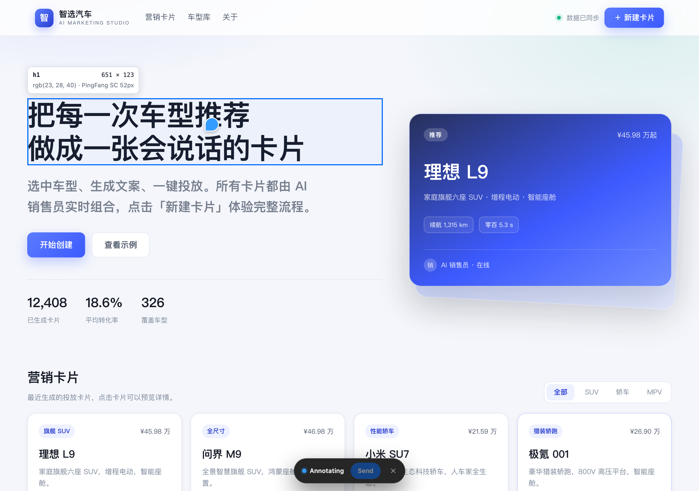
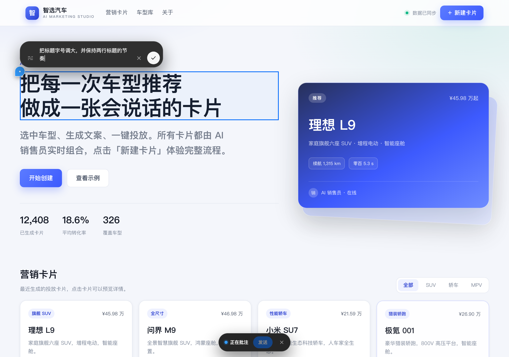
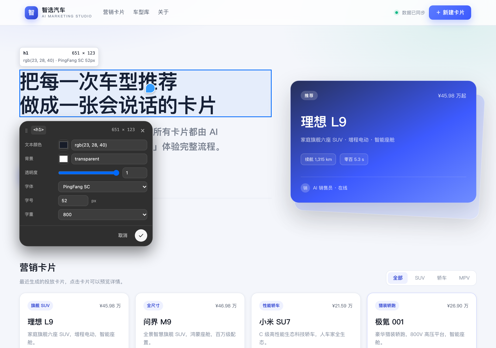

> Point at any element on a web page, leave a note for the AI to fix it — or tweak the styles and text yourself, and every change is written back to source automatically.

**Nudge** is a plugin for DSH Desktop. It puts a real web page in the right sidebar so you can work on it the way you point at things in Figma: no screenshots, no describing "the blue button over there". Point at it, and that is exactly what changes.

## Once installed, you can

- **Pin notes right onto the page**: switch to Annotate, click an element, drag a region or select text, then write what you want changed. Each note becomes a numbered dot that stays out of your way.
- **Edit live**: switch to Edit and tune text, colors, spacing, layout, radius, shadows and more in a floating card. The page updates immediately, with undo / redo.
- **See every layer**: open the page structure (the element hierarchy) next to the page. Click a layer to select it, including dialogs and dynamically inserted content.
- **Undo mistakes safely**: Workspace versions lets you browse files, switch branches, restore a previous version and commit selected files.
- **Never reload by hand**: when a workspace file changes, the page refreshes automatically.

## Who it is for

- **UI designers**: get the real page looking right first, then hand it off to engineering.
- **Product managers**: turn "make this a bit bigger" into a note the AI can execute.
- **Front-end and indie developers**: skip a few rounds of style tweaking; changes go back to source automatically.

## Three steps to start

1. **Open Nudge**: press `⌘⇧I` (`Ctrl+Shift+I` on Windows / Linux), or choose "Open in Nudge" from the Browser card in the right sidebar.
2. **Open a page**: type a URL, or go to Workspace → Files and open a local HTML page.
3. **Start changing things**:
   - Click **Annotate** → pick what to change → write a note → click **Send**.
   - Click **Edit** → click an element → adjust it in the style card.

## Working with the AI

- **Say what to change, not just that it feels off**: "make the heading 56px and keep it on two lines" works better than "this doesn't look right".
- **One note per change**: separate notes are easier to execute than one long paragraph.
- **Review before sending**: notes become an editable card in the chat. Add context, remove what you don't need, then send it with your next message.
- **Watch the page update**: after the AI edits, the page refreshes in Browse mode. Save a version first if you want a safety net.

## FAQ

**Q: Will this change the live website?**
No. Edits preview only in your browser. They are written to your local files only when the page maps to a source file in your workspace; the live server is never touched.

**Q: Why does it sometimes say "Preview only" and not write to source?**
The plugin could not find a source file it can safely write to — for example, the page is rendered by JS, the element is ambiguous in the source, or the workspace is read-only. The message explains the exact reason; adjust and try again.

**Q: I broke something. Can I undo?**
Style edits have undo / redo. Changes already written to source can be restored from Workspace versions → Versions. Keeping the workspace under git makes rollback even safer.

**Q: Do I need to write code?**
No. Annotating, tuning styles and editing text are all click-and-drag. The only requirement for writing changes back is that the page comes from your workspace, and the plugin handles that step itself.

**Q: Can I use it on mobile pages?**
Yes. Narrow the right sidebar or go fullscreen, then annotate or edit. Writing changes back to source works the same way.

**Q: How do updates work?**
Market-installed releases are checked automatically when DSH starts. Open Settings → Nudge → About & updates and click **Update now**; restart DSH to apply. Local development builds do not auto-update.

**Q: Does it slow the page down?**
In Browse mode the page behaves like a normal web page; overlays only appear while you annotate or edit, and they get out of the way when you exit.

**Q: Where do my notes go?**
Notes stay on the page you have open and in the chat you send them to. They only enter the context of your next message once you send them, just like any other chat content.

Install from the plugin market: open the **Plugins** page and switch to **Discover**, add the index source
`https://raw.githubusercontent.com/qizhi2design/nudge/main/market/index.json`, then install **Nudge**.
