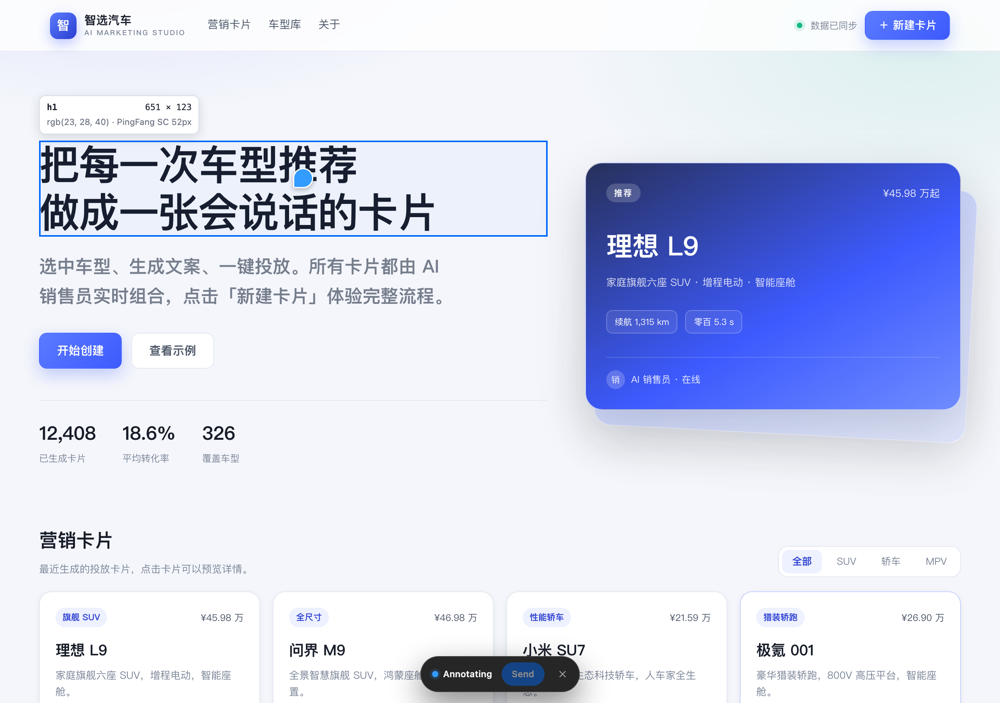
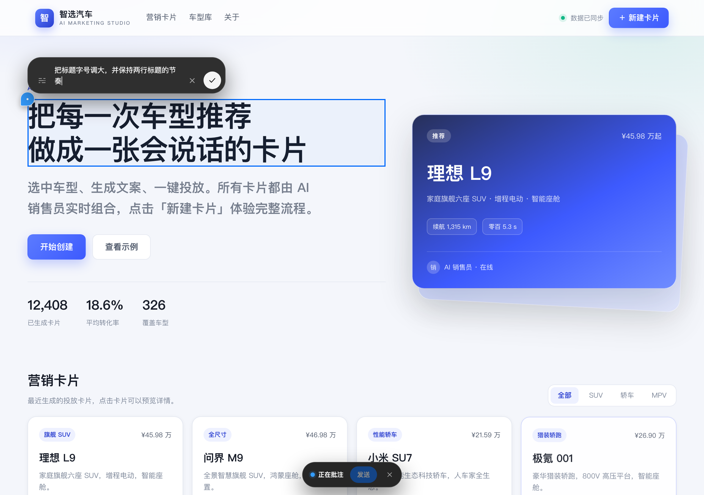
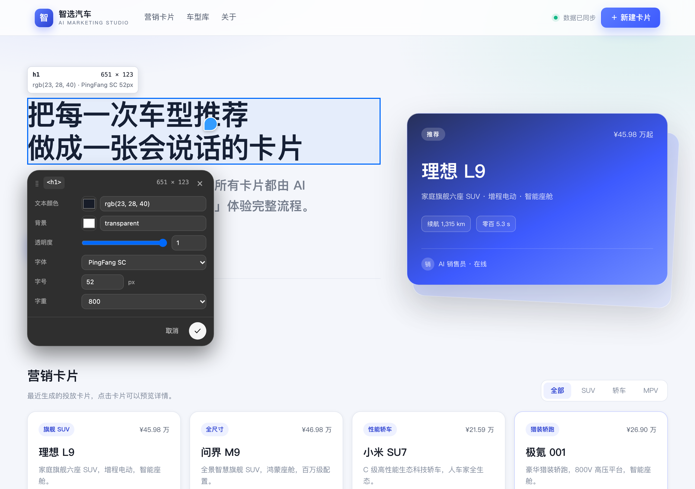

> 点一下网页上的任意元素，写一条批注交给 AI 去改；也可以自己把样式、文字调到满意为止，改完自动写回源码。

**Nudge（轻推）** 是 DSH Desktop 的插件。它把网页装进右侧边栏，让你像在 Figma 里指指点点一样操作真实页面——不用截图、不用费力描述“就是那个蓝色的按钮”，指到哪儿，改的就是哪儿。

## 装好之后，你可以

- **把意见直接钉在页面上**：点「标注」，点元素、拖框或拖选文字，写下想让 AI 怎么改。每条批注都会变成页面上的编号小圆点，不挡视线。
- **自己动手实时改**：点「编辑」，在弹出的样式卡里调文字、颜色、间距、布局、圆角、阴影……改完页面立刻变，还能撤销 / 重做。
- **看清每一层元素**：打开「DOM 树」（页面的元素结构树），页面右侧列出整棵层级，点哪一层就选中哪一层，弹窗和动态内容也能选。
- **改坏了能退回去**：「工作区版本」里能看文件、切分支、恢复历史版本、勾选文件提交。
- **页面自己刷新**：工作区文件一有变化，页面自动更新，不用手动按刷新。

## 适合谁

- **UI 设计师**：先在实际页面上把效果调出来，再交给开发落地。
- **产品经理**：指哪说哪，把“这里再大一点”变成 AI 能直接执行的批注。
- **前端 / 独立开发者**：少写几轮样式，改完自动回写源码。

## 三步开始

1. **打开轻推**：按 `⌘⇧I`（Windows / Linux 用 `Ctrl+Shift+I`），或在右侧边栏「浏览器」卡片里选「在轻推中打开」。
2. **打开页面**：地址栏输入网址；也可以点工具栏「工作区版本」→「文件」，打开你本地的 HTML 页面。
3. **开始改**：
   - 点「标注」→ 选中要改的地方 → 写下意见 → 点「发送」。
   - 点「编辑」→ 点元素 → 在样式卡里实时调整。

## 和 AI 协作的小技巧

- **写“改什么”，而不是“这里不好看”**：例如“标题字号加大到 56，保持两行”。越具体，AI 一次改对的概率越高。
- **一次只批注一件事**：一个元素一条批注，比一条长文更容易执行。
- **发给 AI 前还能改**：批注会变成对话里的一张卡片，可以补说明、删掉不要的条目，再随下一条消息发出去。
- **AI 改完会自动刷新**：回到浏览模式就能看到最新效果；不放心的话，在「工作区版本」里先存一个版本再改。

## 常见问题

**Q：改了会直接改到线上网站吗？**
不会。修改只在你自己的浏览器里预览；只有页面能对应到你本机工作区的源文件时，才会写回你本地的文件，线上服务器不会被动到。

**Q：为什么有时显示“仅预览”，没写进源码？**
说明插件没找到能安全写入的源文件——比如页面是 JS 动态生成的、元素在源码里不唯一，或者当前工作区是只读的。提示里会写具体原因，照着调整再试即可。

**Q：改坏了怎么办？**
样式改动可以撤销 / 重做；已经写回源码的改动，可以在「工作区版本 → 版本」里把文件恢复到历史版本。建议把工作区纳入 git 管理，回退更安心。

**Q：需要会写代码吗？**
不需要。标注、调样式、改文字都是点选和拖拽；只有“把修改写回源码”这一步需要页面在你的工作区里，插件会自己完成。

**Q：能改手机页面吗？**
先窄化右侧边栏或全屏查看，再用标注 / 编辑；写回源码的能力和桌面页面一样。

**Q：插件怎么更新？**
从插件市场安装的正式版会在 DSH 启动时自动检查新版本，设置 →「轻推」→「关于与更新」里点「立即更新」即可，重启 DSH 后生效。本地开发版不参与在线更新。

**Q：插件会拖慢页面吗？**
浏览模式下页面就是普通网页；只有进入标注 / 编辑时才会出现浮层，退出后不打扰正常使用。

**Q：我的批注会保存到哪？**
批注只在你当前打开的页面和对话里使用；点「发送」后才会进入下一条消息的上下文，和普通对话内容一样处理。

从插件市场安装：打开左侧边栏的「插件」页，切到「发现」，添加索引源
`https://raw.githubusercontent.com/qizhi2design/nudge/main/market/index.json`，找到 **Nudge（轻推）** 点安装即可。
